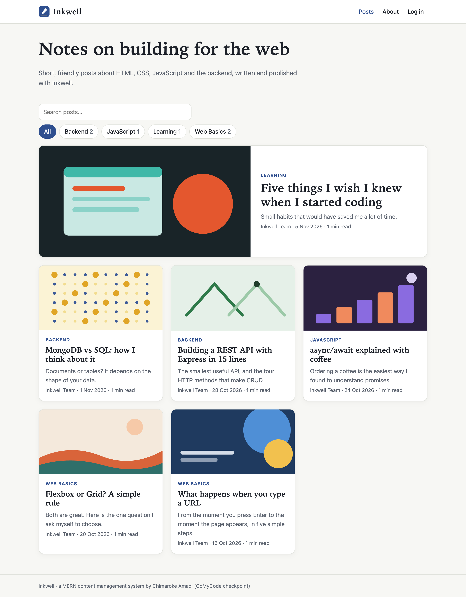
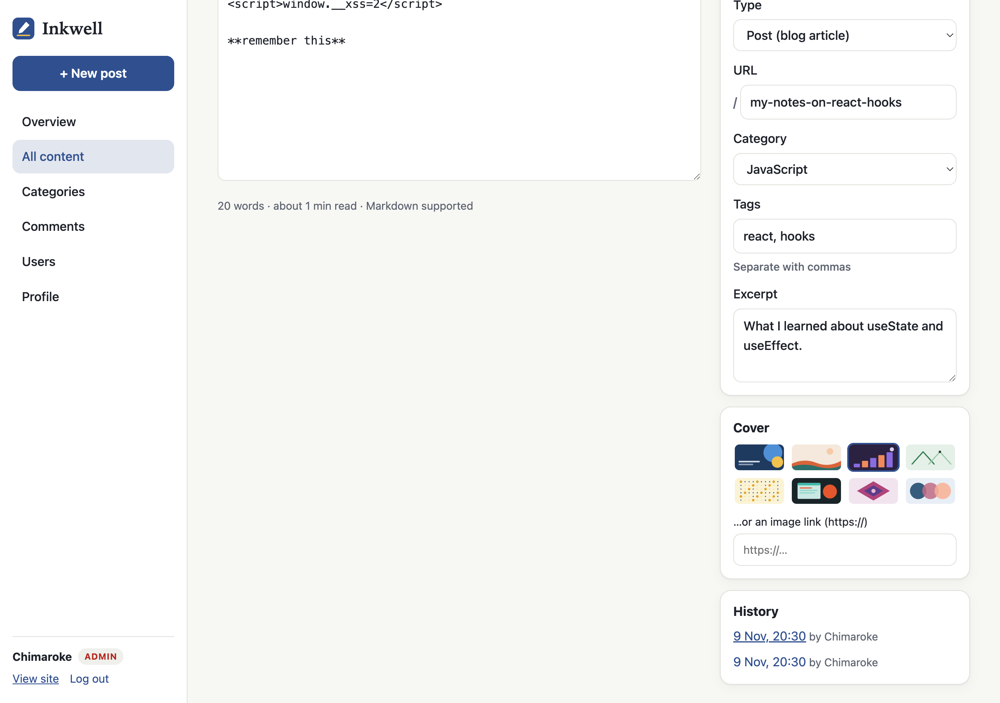
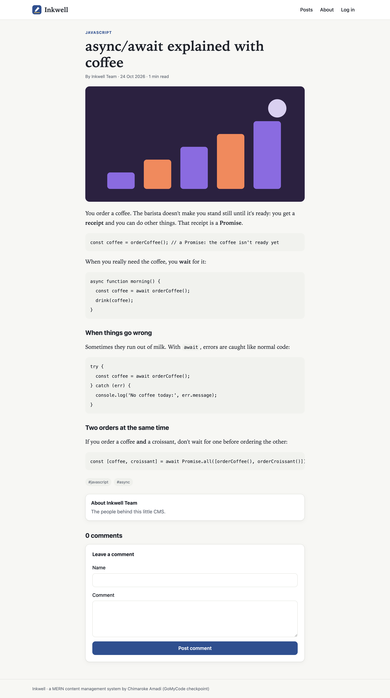
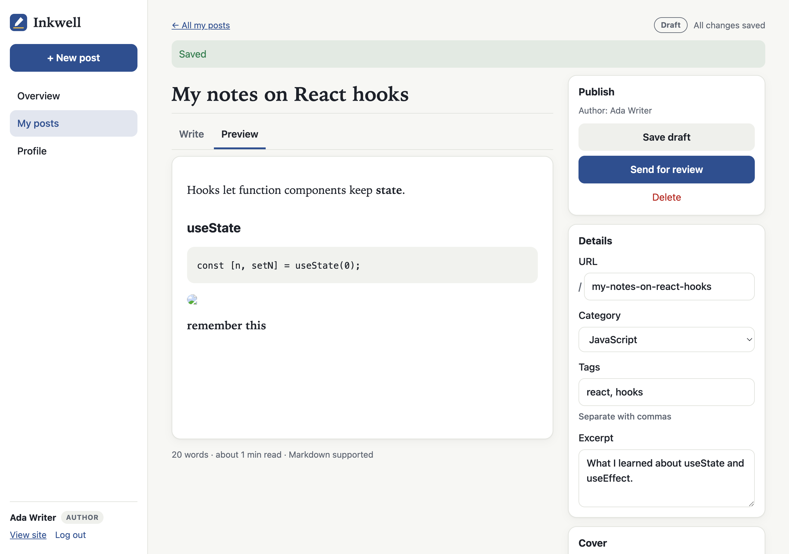
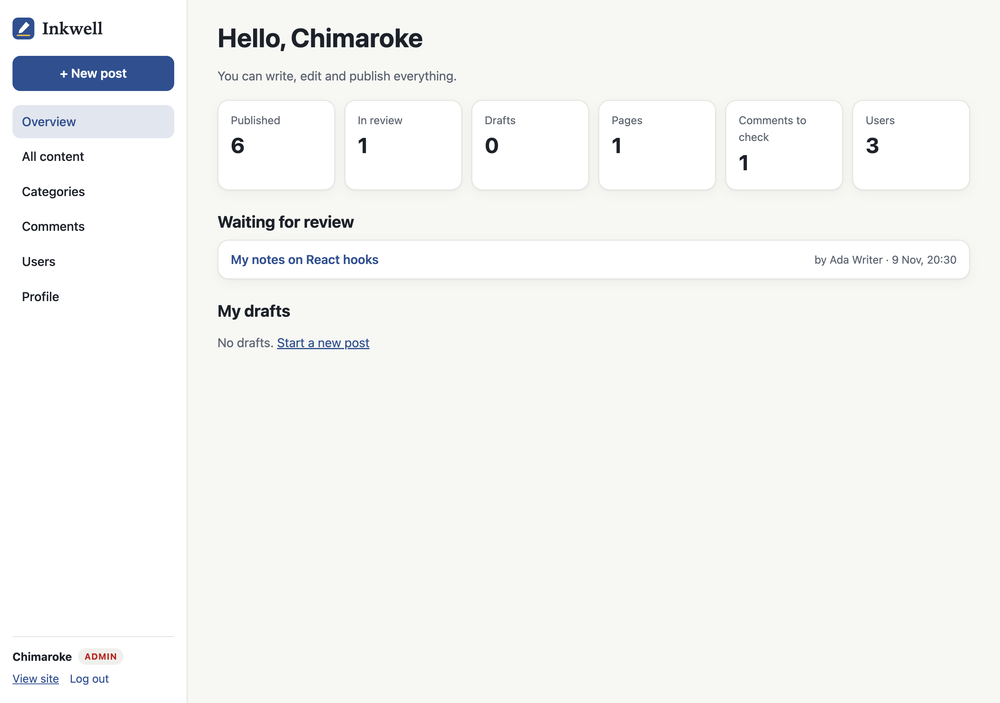
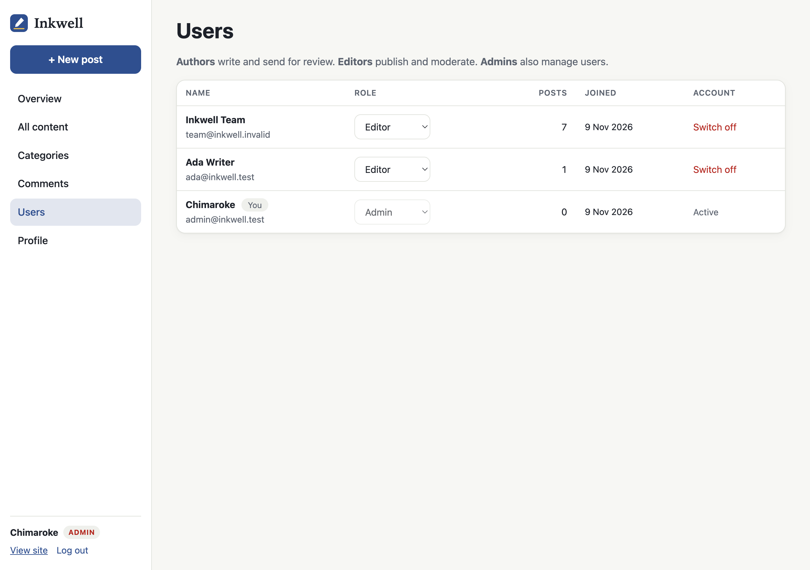
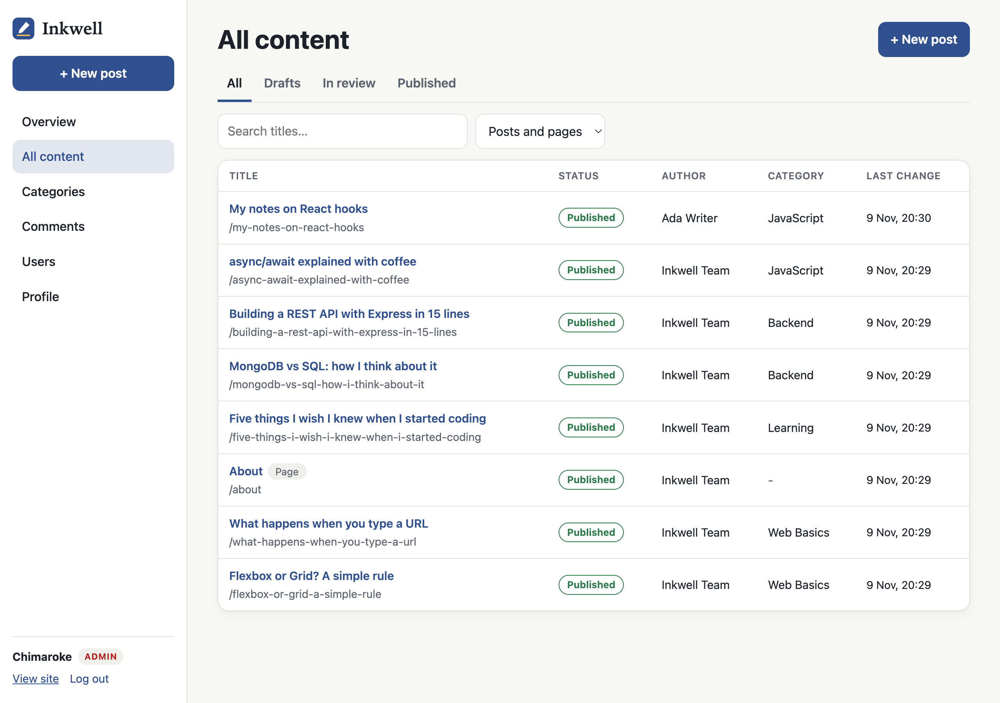
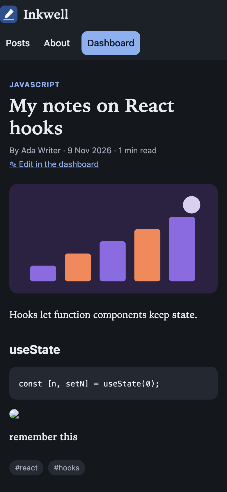

# Inkwell: a Content Management System (MERN)

**Live app:** https://chimaroke-inkwell-hpg3guadambrcecu.westus3-01.azurewebsites.net

(It's on Azure's free plan, so if nobody visited for a while, the first page can take up to a minute to wake up. To try the dashboard, create an account: you'll be an author.)

Inkwell is the content management system (CMS) I built for my GoMyCode MERN checkpoint. A CMS is a website where a team can write, edit and publish content without touching any code. Inkwell has two sides: the **public site**, a blog with posts, pages and comments, and the **dashboard**, where people log in to write and manage everything. The frontend is React, the backend is Node.js with Express, and everything is stored in MongoDB Atlas through Mongoose. Like my e-commerce project, it runs as one app on Microsoft Azure App Service.



## Who can do what

The main idea of a CMS is that not everyone can do everything, so Inkwell has three roles:

- **Author**: writes posts, saves them as drafts and **sends them for review**. An author can't publish, and once a post is published they can't change it anymore. Everyone who creates an account starts as an author.
- **Editor**: sees all the posts, edits them, **publishes** and unpublishes them, makes pages (like About), manages the categories and **approves comments**.
- **Admin**: everything an editor can do, plus managing the users: changing their role, or switching an account off (their posts stay). The account registered with the `ADMIN_EMAIL` email is the admin.

So the life of a post is: **draft → in review → published**. Drafts and posts in review are never shown on the public site, the API only ever returns published content to visitors.

## What's in the dashboard

- **Overview**: a few numbers (published, in review, drafts, comments to check…), the posts waiting for review, and my drafts.
- **Content list**: all posts and pages with tabs for each status, a search box and a filter for posts or pages.
- **Editor**: a title, a Markdown body with a small toolbar (bold, italic, heading, list, link, code, quote), a **Preview** tab, and a side panel with the publish buttons, the URL, the category, the tags, the excerpt and a cover picture. `Cmd+S` (or `Ctrl+S`) saves, and the browser warns you before closing with unsaved changes.
- **History**: every time the text of a post changes, the old version is saved as a revision first. You can open any older version and restore it, and restoring also saves the current text first, so it can be undone too. Only the last 20 versions of each post are kept.
- **Categories**: add, rename, delete. A category that is still used by posts can't be deleted.
- **Comments**: visitors' comments wait in "pending" until an editor approves them.
- **Users** (admin only) and **Profile**, where you set the short bio shown under your posts.



## Things I paid attention to

**Safe Markdown.** Posts are written in Markdown and turned into HTML in the browser with `marked`. Showing HTML written by users is dangerous: someone could put a `<script>` or an `` in a post and run code in every visitor's browser. So the HTML is always cleaned with **DOMPurify** before it is shown. I tested it by putting both of those in a post, publishing it, and checking that nothing ran.

**Permissions are checked on the server, not only hidden in the React app.** An author who sends a request to publish directly gets a 403, and an author who asks for someone else's post gets a 404, as if it didn't exist. The tests check these cases.

**Spam.** Comments need approval, each visitor (IP address) can only post 5 comments every 10 minutes, and the form has a hidden "website" field that people can't see but bots fill in. When it's filled, the server pretends it worked but doesn't save anything.

**URLs.** Each post gets a readable URL made from its title (`/async-await-explained-with-coffee`). If the title is already used, it becomes `-2`, `-3`… Editors can change the URL, and the server refuses a URL that is already taken.

**Starter content.** The first time the app connects to an empty database, it adds 4 categories, 6 posts and an About page (in `data/content.js`), written by an "Inkwell Team" account that nobody can log in to. That way the deployed site isn't empty.

## How it's built

```
server.js            Express app: API routes, errors, serves the React build
seed.js              adds the starter content when the database is empty
models/              User, Post (posts and pages), Category, Comment, Revision
routes/auth.js       register, login, my profile
routes/public.js     what visitors can read (published only) + posting comments
routes/posts.js      writing and managing posts, revisions and restore
routes/manage.js     categories, comments, users, dashboard numbers
middleware/auth.js   checks the login token and the roles
client/              the React app (Vite + React Router + marked + DOMPurify)
public/              the built React app (made by npm run build:client)
scripts/             make-covers.js (draws the cover pictures), copy-to-azure-repo.sh
test/api.test.js     12 tests on the whole API
```

The cover pictures are abstract SVG drawings made by `scripts/make-covers.js`.

### The API

| Method | URL | Who | What it does |
|---|---|---|---|
| POST | /api/auth/register, /api/auth/login | anyone | create an account / log in |
| GET, PUT | /api/auth/me | logged in | my account, change my name and bio |
| GET | /api/public/posts | anyone | published posts (`search`, `category`, `tag`, `page`) |
| GET | /api/public/posts/:slug | anyone | one published post or page, with approved comments |
| GET | /api/public/pages, /api/public/categories | anyone | menu pages, categories with counts |
| POST | /api/public/posts/:slug/comments | anyone | leave a comment (waits for approval) |
| GET, POST | /api/posts | logged in | list (authors: only theirs) / create |
| GET, PUT, DELETE | /api/posts/:id | owner or editor | read / save / delete |
| GET | /api/posts/:id/revisions | owner or editor | older versions |
| POST | /api/posts/:id/revisions/:rev/restore | owner or editor | restore a version |
| GET, POST, PUT, DELETE | /api/categories(/:id) | editor (GET: logged in) | categories |
| GET, PATCH, DELETE | /api/comments(/:id) | editor | moderation |
| GET, PATCH | /api/users(/:id) | admin | roles and accounts |
| GET | /api/stats | logged in | numbers for the dashboard |

## Running it on my computer

```bash
npm install
npm run build:client   # builds the React app into public/
npm run local          # starts with a temporary in-memory MongoDB
npm test               # runs the 12 API tests
```

Then open http://localhost:3000. With `npm run local` you don't need MongoDB or a `.env` file. Register with `admin@inkwell.test` to be the admin, and with any other email to see what an author can do. Everything disappears when you stop it.

To use MongoDB Atlas instead, copy `config/.env.example` to `config/.env`, fill in `MONGO_URI`, `JWT_SECRET` and `ADMIN_EMAIL`, and run `npm start`. The `.env` file is in `.gitignore`, so the passwords never go to GitHub.

## Deployment on Azure

Same steps as my e-commerce project:
1. `npm run build:client`, so `public/` holds the site.
2. Create a Web App on Azure App Service (Linux, Node 22, the free F1 plan I already have) and turn on Local Git in the Deployment Center.
3. Add `MONGO_URI` (Atlas, database `cms`), `JWT_SECRET` and `ADMIN_EMAIL` in the Web App's environment variables.
4. Clone the Azure Git repo, copy the app into it with `sh scripts/copy-to-azure-repo.sh <folder>`, then commit and push. Azure installs the packages and runs `npm start`.

This time it went faster because I already knew the tricky part: the Git password is hidden in the portal, so I got it with the Azure Cloud Shell (`az webapp deployment list-publishing-credentials`) and put the username `$chimaroke-inkwell` in the clone URL. On the first start, the app filled the empty `cms` database with the starter posts by itself.

## Screenshots

| | |
|---|---|
|  |  |
|  |  |
|  |  |
