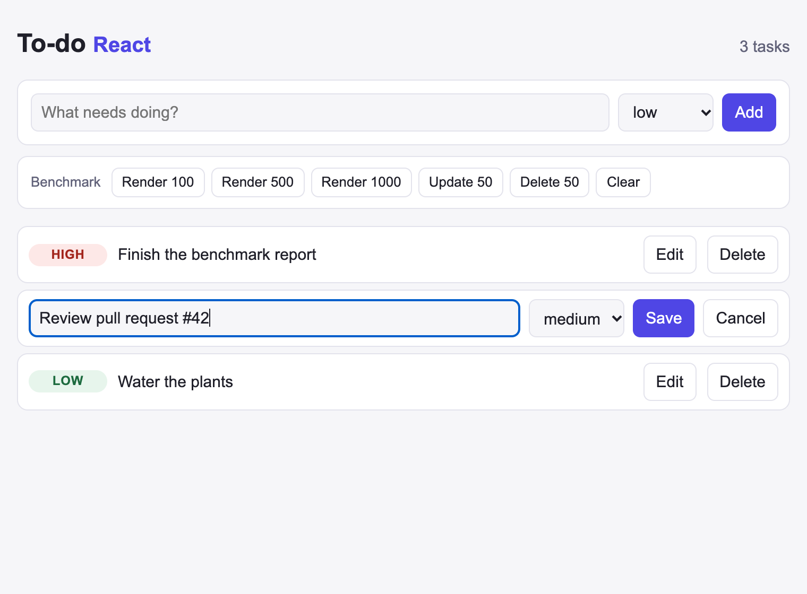
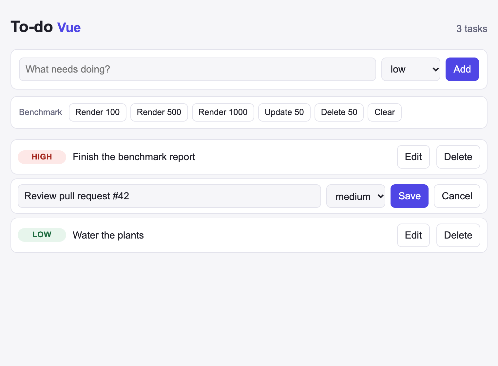
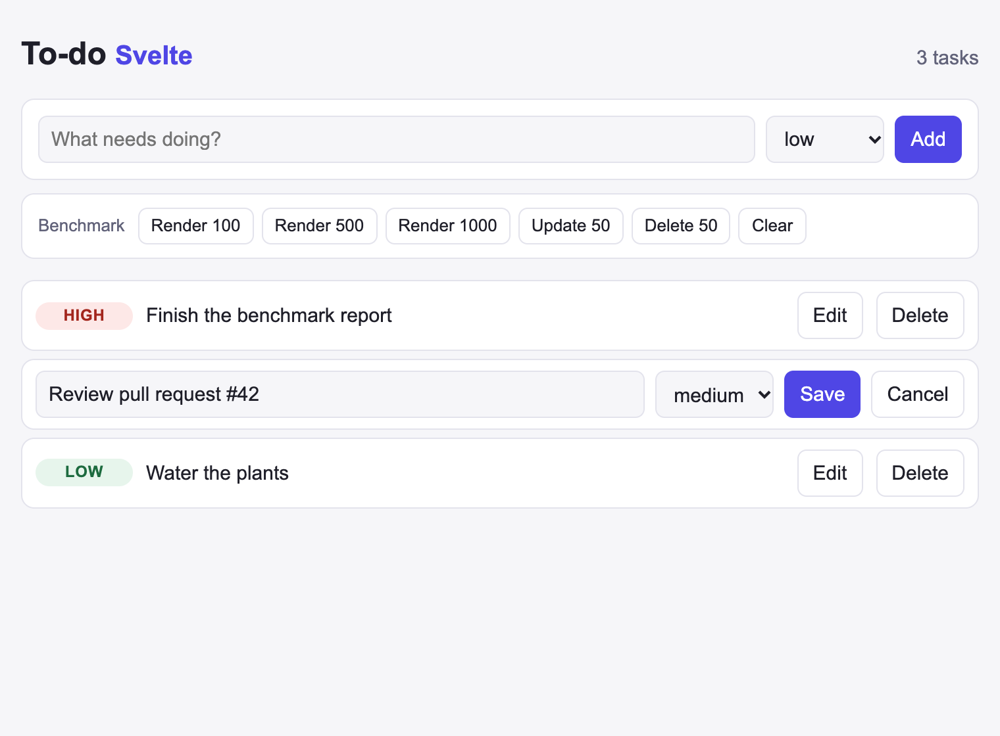
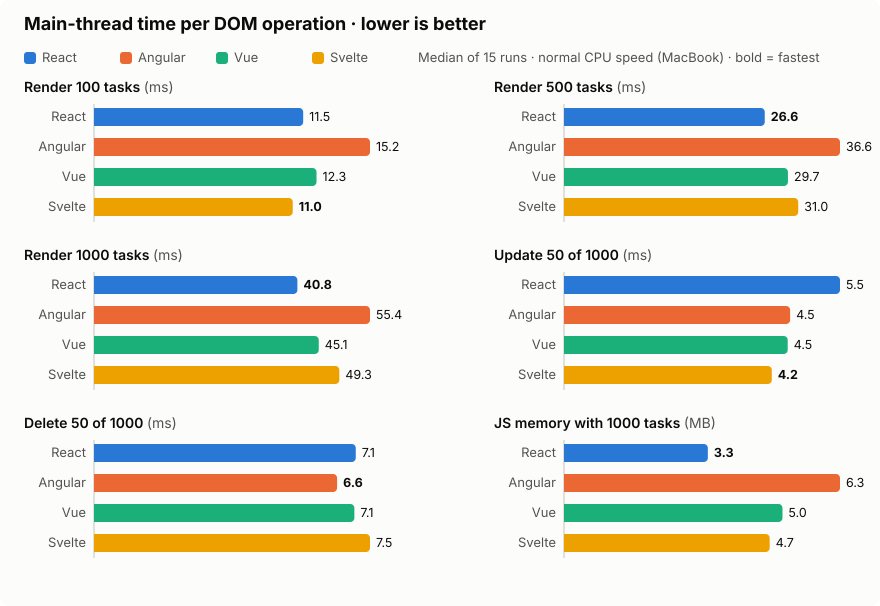
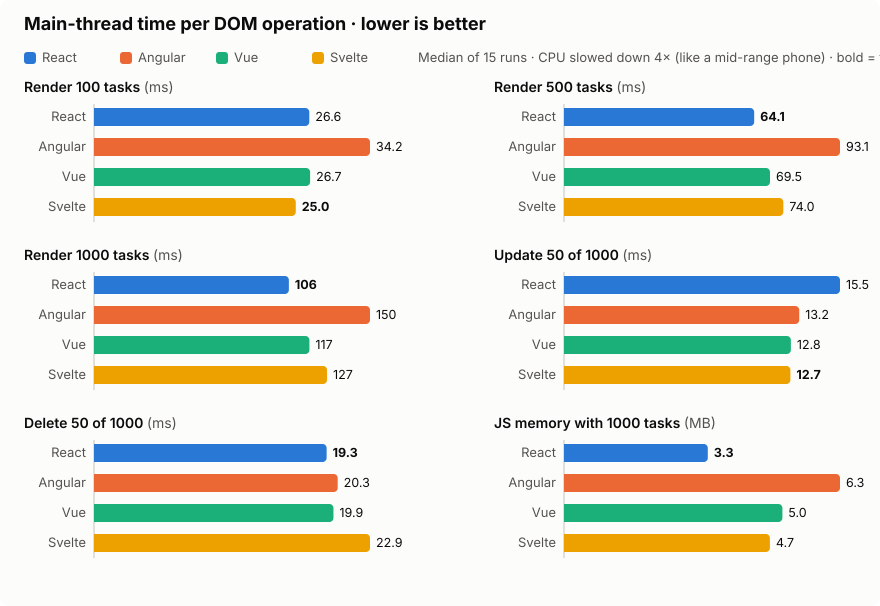

# DOM benchmark: React vs Angular vs Vue vs Svelte

For this checkpoint I built the same to-do list app four times, in **React**, **Angular**, **Vue** and **Svelte**, and measured how fast each one renders, updates and deletes tasks in the DOM. Everything is in this folder: the four apps, the benchmark scripts, the raw results and the charts.

| React | Angular |
|---|---|
|  |  |
| **Vue** | **Svelte** |
|  |  |

## The app

Each app lets you **add** a task with a name and a priority (low, medium, high), **see** all the tasks with a coloured priority badge, **edit** a task's name or priority (Edit → Save or Cancel), and **delete** it. Under the form there's a row of benchmark buttons: Render 100, 500 and 1000 tasks, Update 50, Delete 50 and Clear. When you click one, the time it took appears at the bottom of the page.

Each one is written the way that framework is meant to be used:

- **React** (`apps/react`): a `useReducer` for the list, and a `TaskRow` component wrapped in `React.memo`. The reducer never changes a task, it makes a new one, so React can tell which rows changed and skip the rest.
- **Angular** (`apps/angular`): `*ngFor` with `trackBy`, `*ngIf` for the edit mode, and `[(ngModel)]` two-way binding in the forms. It's Angular 21, which runs without zone.js by default. The row component uses an attribute selector (`li[app-task-row]`), so it doesn't add an extra element to every row.
- **Vue** (`apps/vue`): a `ref([])` with `v-for`, `v-if` and `v-model`. Vue's reactivity tracks which task each row reads, so changing `task.name` updates only that row.
- **Svelte** (`apps/svelte`): Svelte 5 with `$state` and a keyed `{#each}`. The compiler turns the template into code that changes exactly the text that depends on a value, with no virtual DOM.

## Making it a fair comparison

Comparing frameworks is only useful if they all do the same work, so:

- **Same data.** All four apps import `shared/tasks.js`, which makes the task names with a seeded random generator. Render 1000 produces exactly the same 1000 tasks in every framework.
- **Same HTML and CSS.** Every row has the same elements and classes, and all four apps use `shared/styles.css`.
- **The tests prove it.** `npm test` runs 33 checks in a real Chrome. It adds, edits, cancels and deletes tasks in each app, clicks every benchmark button, and checks that the four frameworks render exactly the same tasks.
- **Same operations.** "Update 50" and "Delete 50" don't just take the first 50 tasks. They take 50 tasks spread across the whole list of 1000 (the 1st, the 21st, the 41st…), so the framework has to find them.
- **Production builds** for all four, served by the same small static server.

## How I measured

`benchmark/run.js` uses **puppeteer-core** to control Chrome through the **Chrome DevTools Protocol**, the same connection the DevTools panel uses. For every single measurement it:

1. opens the app in a new tab (so nothing is left over from the run before);
2. prepares the list if needed, for example 1000 tasks before "Update 50" (this part isn't timed);
3. waits until the page is quiet and runs the garbage collector, so a cleanup doesn't happen in the middle of the measurement;
4. clicks the button and records the time.

Each operation is measured **15 times per framework**, taking turns between frameworks so that a slow moment on my laptop doesn't only hit one of them. I report the **median**.

The main number is the **main-thread time**: how long Chrome was busy with the operation, meaning the framework's JavaScript plus style, layout and paint. It comes from DevTools' own `TaskDuration` counter. I also recorded **time to paint** (from the click until the result is on screen), but for small operations it jumps between about 5 and 20 ms on the same code. That depends on where the click lands in the screen's 60 Hz refresh cycle, not on the framework. All the numbers are in [benchmark/results/RESULTS.md](benchmark/results/RESULTS.md).

I ran everything twice: at normal speed on my MacBook, and with Chrome's **CPU slowed down 4×**, which is closer to a mid-range phone. Memory is the JavaScript heap after rendering 1000 tasks, after garbage collection.

## Results

### Normal CPU speed



| Main-thread time (ms) | React | Angular | Vue | Svelte |
|---|---:|---:|---:|---:|
| Render 100 tasks | 11.5 | 15.2 | 12.3 | **11.0** |
| Render 500 tasks | **26.6** | 36.6 | 29.7 | 31.0 |
| Render 1000 tasks | **40.8** | 55.4 | 45.1 | 49.3 |
| Update 50 of 1000 | 5.5 | 4.5 | 4.5 | **4.2** |
| Delete 50 of 1000 | 7.1 | **6.6** | 7.1 | 7.5 |

### CPU slowed down 4×



| Main-thread time (ms) | React | Angular | Vue | Svelte |
|---|---:|---:|---:|---:|
| Render 100 tasks | 26.6 | 34.2 | 26.7 | **25.0** |
| Render 500 tasks | **64.1** | 93.1 | 69.5 | 74.0 |
| Render 1000 tasks | **105.8** | 149.8 | 116.9 | 126.5 |
| Update 50 of 1000 | 15.5 | 13.2 | 12.8 | **12.7** |
| Delete 50 of 1000 | **19.3** | 20.3 | 19.9 | 22.9 |

### Memory and size

| | React | Angular | Vue | Svelte |
|---|---:|---:|---:|---:|
| JS heap with 1000 tasks (MB) | **3.3** | 6.3 | 5.0 | 4.7 |
| DOM nodes with 1000 tasks | **9,086** | 12,092 | 9,088 | 14,179 |
| JavaScript bundle (KB, gzip) | 67.6 | 53.3 | 27.0 | **16.4** |

Bold = best. Chrome 157, 15 runs per operation. The standard deviations and the time-to-paint tables are in [RESULTS.md](benchmark/results/RESULTS.md).

**What stood out to me:**

- **Style and layout cost exactly the same in all four** (about 19 ms of the 1000-task render at normal speed, 58 ms at 4×), because the DOM they produce is the same. So the differences between frameworks come only from their JavaScript. If you take the style and layout out of the 1000-task render, React needs about 20 ms of JavaScript and Angular about 37 ms.
- The ranking for rendering stayed the same at both CPU speeds: React, then Vue, then Svelte, then Angular.
- Angular and Svelte have more DOM nodes even though the rows look identical. Both leave invisible comment or text "anchors" in the page to remember where an `*ngIf` or `{#if}` block goes.

## Reflection

**What challenges did I face?** The hardest part was making the comparison fair, not writing the apps. I gave all four the same data, the same HTML and the same CSS, and my tests check they render identical text. Timing was tricky too: "time until painted" jumped between 5 and 20 ms on the same code, because it depends on the screen refresh, so I switched to Chrome's main-thread time. React re-rendered every row until I used `React.memo` with immutable updates. Angular needed `trackBy`, and my tests found a bug where `ngModel` sometimes didn't clear the input without zone.js. Vue and Svelte needed almost no tuning.

**How did each approach affect performance?** Style and layout cost the same everywhere, so only the JavaScript differed. React's virtual DOM was cheap for creating rows. Vue and Svelte wrap every task in a reactive proxy, which costs time and memory at creation but lets them update one row without touching the others. Angular checks every binding after each change and keeps extra comment nodes for `*ngIf`, so it was slowest to render and used the most memory.

**Which framework did best, and why?** React rendered 1000 tasks fastest (40.8 ms, against Vue 45.1, Svelte 49.3 and Angular 55.4), and the order stayed the same on a 4× slower CPU. Updating 50 tasks went to the fine-grained frameworks, Svelte (4.2 ms), Vue and Angular (4.5), because React still loops over all 1000 rows. Deleting was a tie. Svelte had the smallest bundle. No framework wins everything, and at this size all four are fast enough.

## Running it yourself

You need Node.js 20.19 or newer and Google Chrome. If Chrome isn't in a usual place, set `CHROME_PATH` to its executable.

```bash
npm run install:all     # installs the benchmark tools and the four apps
npm run build           # production build of the four apps
npm test                # 33 functional tests in Chrome
npm run serve           # open the apps: http://localhost:5100/react/ (also /angular/, /vue/, /svelte/)
npm run bench           # the benchmark (RUNS=15 CPU=4 npm run bench for the slow-CPU run)
npm run chart           # rebuilds RESULTS.md and the charts from the JSON results
```

Each app can also be started on its own for development: `npm run dev` in `apps/react`, `apps/vue` or `apps/svelte`, and `npm start` in `apps/angular`.

```
apps/react, apps/angular, apps/vue, apps/svelte   the four to-do apps
shared/            data generator, timing helper and CSS used by all four
benchmark/         serve.js, check.js (tests), run.js (benchmark), chart.js, screenshots.js
benchmark/results/ raw JSON results, RESULTS.md and the two charts
```

## Limits of this benchmark

These results come from one laptop, one browser (Chrome), and one fairly simple app. A different machine will give different numbers, though the ranking should be similar. Each framework is tested the normal way you'd write it, not squeezed for the last millisecond. Svelte, for example, has `$state.raw` to skip the proxies, and Angular has `OnPush` and signals, and both could change the results. For a really thorough comparison, the open-source js-framework-benchmark project tests many more cases.
