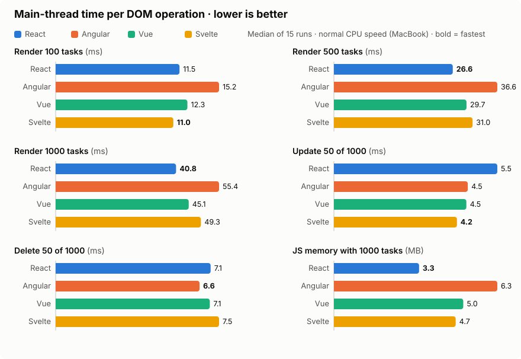
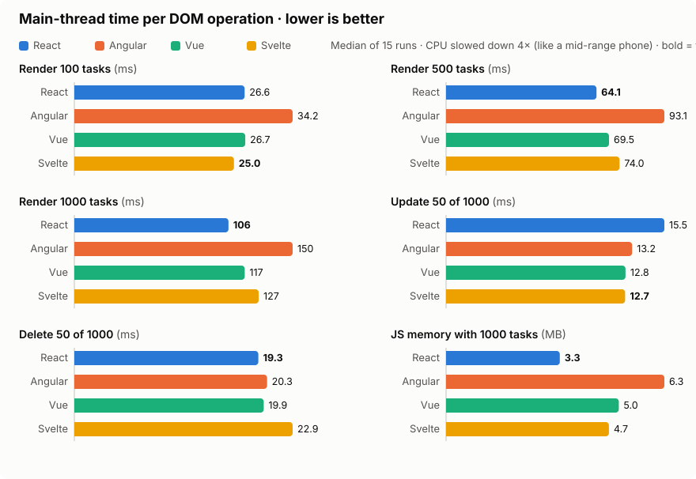

# Benchmark results

Made by `npm run chart` from the JSON files in this folder. All times are in milliseconds, median of the runs, **bold = fastest**.

- **Main-thread time** (± standard deviation) is how long Chrome's main thread was busy with the operation: the framework's JavaScript, style, layout and paint (Chrome DevTools' `TaskDuration` counter). This is the main result.
- **Time to paint** is from the click until the result is on screen. It's closer to what a user feels, but it moves by up to ~16 ms depending on when the click lands in the screen's refresh cycle, so it's noisier.

## Normal CPU speed

Chrome/157.0.8103.52, 15 runs per operation, 2026-11-14.

| Main-thread time (ms) | React | Angular | Vue | Svelte |
|---|---:|---:|---:|---:|
| Render 100 tasks | 11.5 ± 1.7 | 15.2 ± 1.2 | 12.3 ± 0.7 | **11.0 ± 1.4** |
| Render 500 tasks | **26.6 ± 1.0** | 36.6 ± 3.1 | 29.7 ± 1.2 | 31.0 ± 2.0 |
| Render 1000 tasks | **40.8 ± 1.6** | 55.4 ± 3.1 | 45.1 ± 3.6 | 49.3 ± 4.2 |
| Update 50 of 1000 | 5.5 ± 0.2 | 4.5 ± 0.1 | 4.5 ± 0.3 | **4.2 ± 0.1** |
| Delete 50 of 1000 | 7.1 ± 0.4 | **6.6 ± 0.3** | 7.1 ± 0.4 | 7.5 ± 0.4 |

| Time to paint (ms) | React | Angular | Vue | Svelte |
|---|---:|---:|---:|---:|
| Render 100 tasks | **11.8** | 18.4 | 12.6 | 13.9 |
| Render 500 tasks | **25.5** | 35.6 | 28.8 | 29.7 |
| Render 1000 tasks | **39.8** | 54.3 | 44.0 | 48.0 |
| Update 50 of 1000 | 5.6 | 19.4 | **5.1** | 19.6 |
| Delete 50 of 1000 | 7.2 | 17.9 | **7.0** | 21.1 |

| Style + layout (ms) | React | Angular | Vue | Svelte |
|---|---:|---:|---:|---:|
| Render 100 tasks | 3.2 | 2.9 | 3.2 | 3.3 |
| Render 500 tasks | 11.1 | 10.2 | 11.0 | 11.0 |
| Render 1000 tasks | 20.6 | 18.4 | 19.4 | 18.9 |
| Update 50 of 1000 | 2.1 | 2.0 | 2.1 | 2.0 |
| Delete 50 of 1000 | 1.4 | 1.3 | 1.4 | 1.5 |

| Memory and size | React | Angular | Vue | Svelte |
|---|---:|---:|---:|---:|
| JS heap, empty list (MB) | 1.31 | 1.86 | 1.09 | 0.99 |
| JS heap, 1000 tasks (MB) | 3.28 | 6.29 | 4.98 | 4.69 |
| DOM nodes, 1000 tasks | 9086 | 12092 | 9088 | 14179 |
| JS bundle (KB, gzip) | 67.6 | 53.3 | 27.0 | 16.4 |

## CPU slowed down 4×

Chrome/157.0.8103.52, 15 runs per operation, 2026-11-14.

| Main-thread time (ms) | React | Angular | Vue | Svelte |
|---|---:|---:|---:|---:|
| Render 100 tasks | 26.6 ± 1.5 | 34.2 ± 1.4 | 26.7 ± 1.8 | **25.0 ± 1.0** |
| Render 500 tasks | **64.1 ± 3.1** | 93.1 ± 3.2 | 69.5 ± 1.9 | 74.0 ± 1.7 |
| Render 1000 tasks | **105.8 ± 4.2** | 149.8 ± 3.4 | 116.9 ± 2.2 | 126.5 ± 5.0 |
| Update 50 of 1000 | 15.5 ± 1.5 | 13.2 ± 0.8 | 12.8 ± 0.4 | **12.7 ± 1.1** |
| Delete 50 of 1000 | **19.3 ± 0.9** | 20.3 ± 0.9 | 19.9 ± 0.8 | 22.9 ± 1.1 |

| Time to paint (ms) | React | Angular | Vue | Svelte |
|---|---:|---:|---:|---:|
| Render 100 tasks | 25.4 | 32.8 | 26.2 | **23.6** |
| Render 500 tasks | **60.7** | 89.7 | 66.5 | 70.4 |
| Render 1000 tasks | **101.8** | 148.2 | 112.3 | 122.2 |
| Update 50 of 1000 | 21.9 | **14.6** | 23.1 | 14.6 |
| Delete 50 of 1000 | 26.7 | 21.6 | 25.0 | **21.4** |

| Style + layout (ms) | React | Angular | Vue | Svelte |
|---|---:|---:|---:|---:|
| Render 100 tasks | 7.7 | 7.3 | 7.5 | 7.7 |
| Render 500 tasks | 29.0 | 30.2 | 28.6 | 29.3 |
| Render 1000 tasks | 57.8 | 59.6 | 58.2 | 58.1 |
| Update 50 of 1000 | 6.0 | 5.6 | 5.6 | 6.0 |
| Delete 50 of 1000 | 3.8 | 3.7 | 3.7 | 4.3 |

| Memory and size | React | Angular | Vue | Svelte |
|---|---:|---:|---:|---:|
| JS heap, empty list (MB) | 1.31 | 1.86 | 1.09 | 0.99 |
| JS heap, 1000 tasks (MB) | 3.28 | 6.30 | 4.98 | 4.70 |
| DOM nodes, 1000 tasks | 9086 | 12092 | 9088 | 14179 |
| JS bundle (KB, gzip) | 67.6 | 53.3 | 27.0 | 16.4 |
