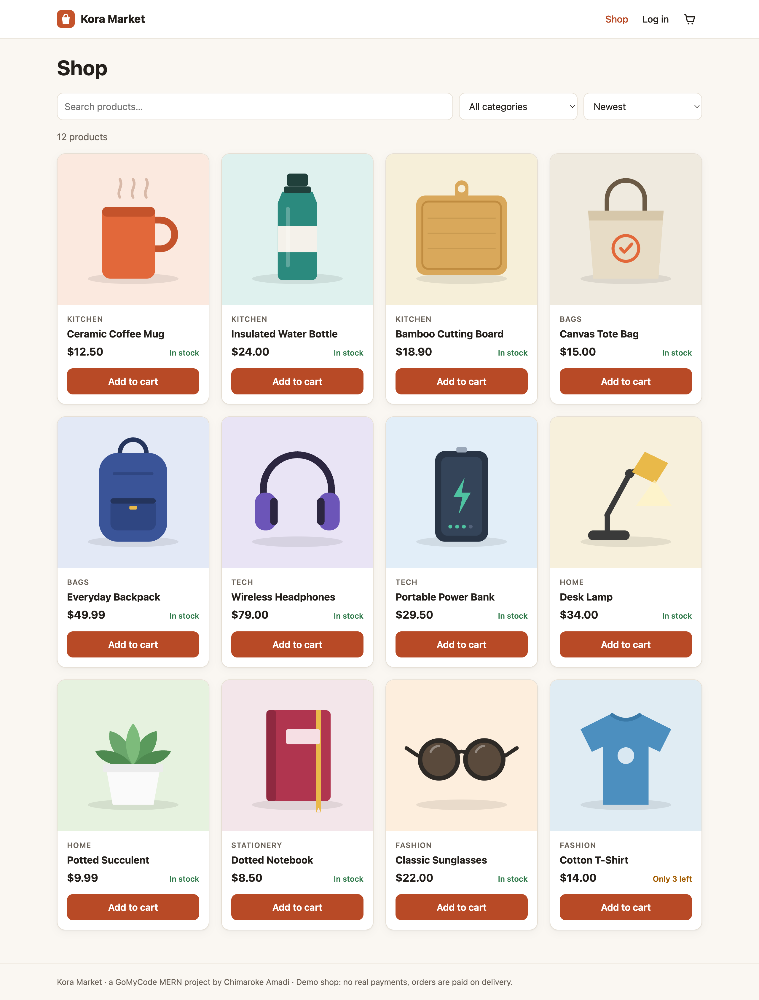
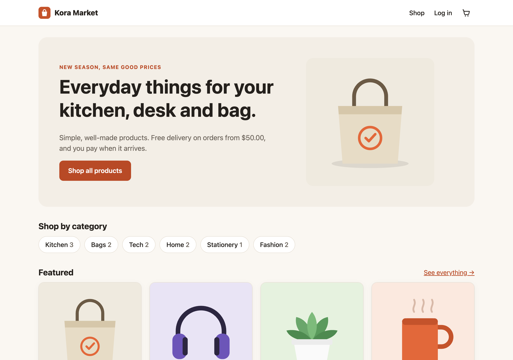
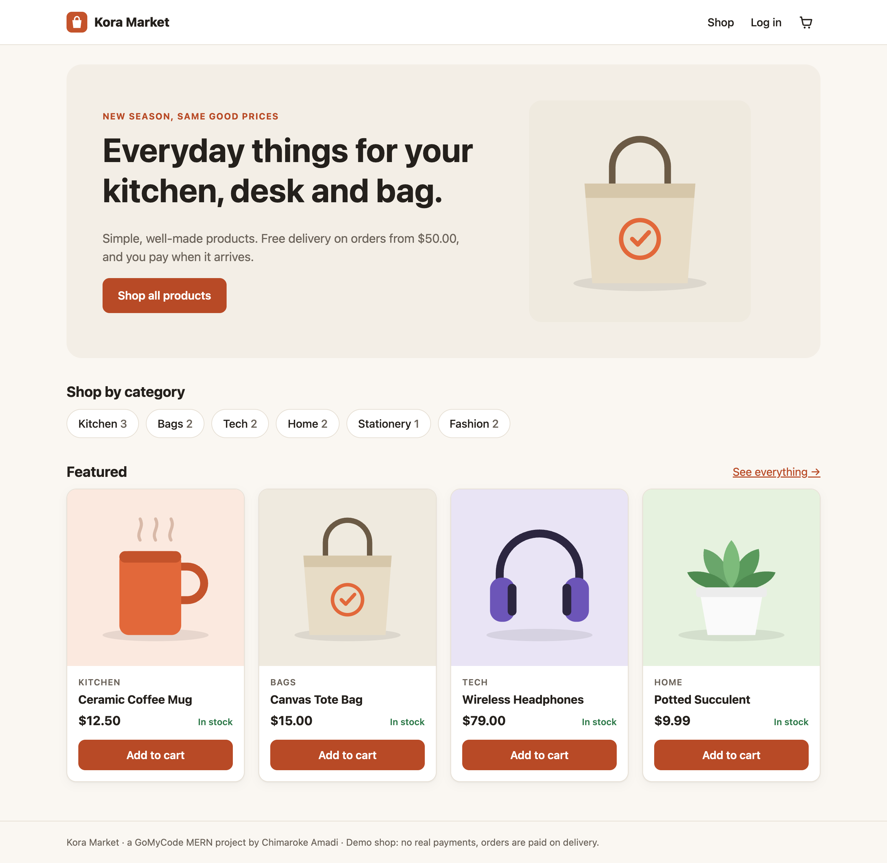
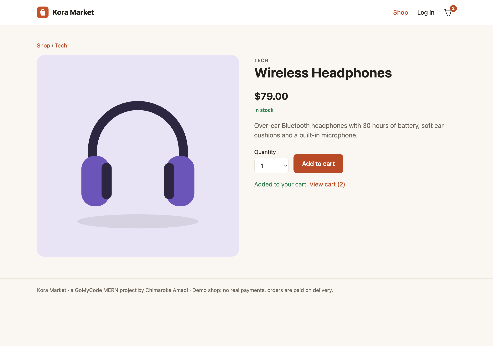
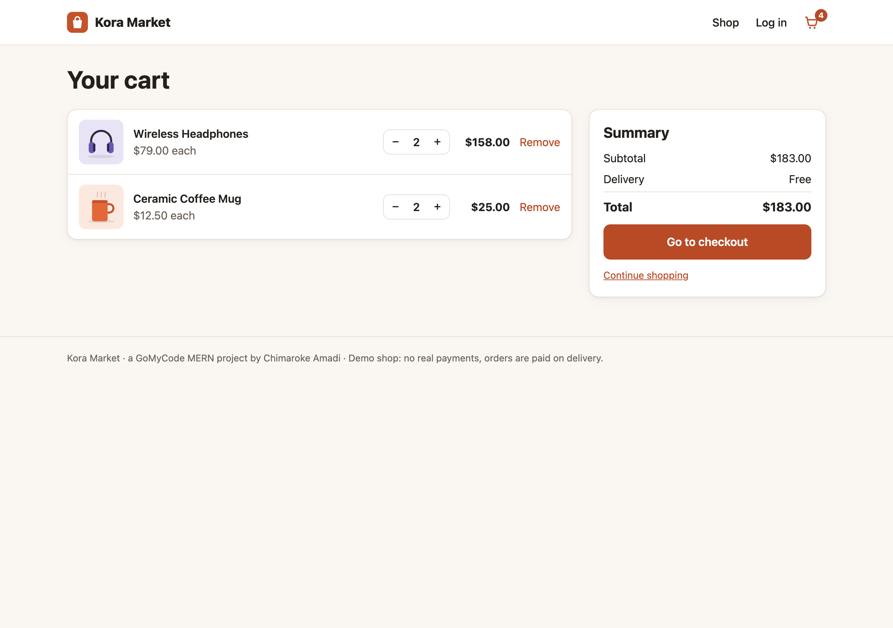
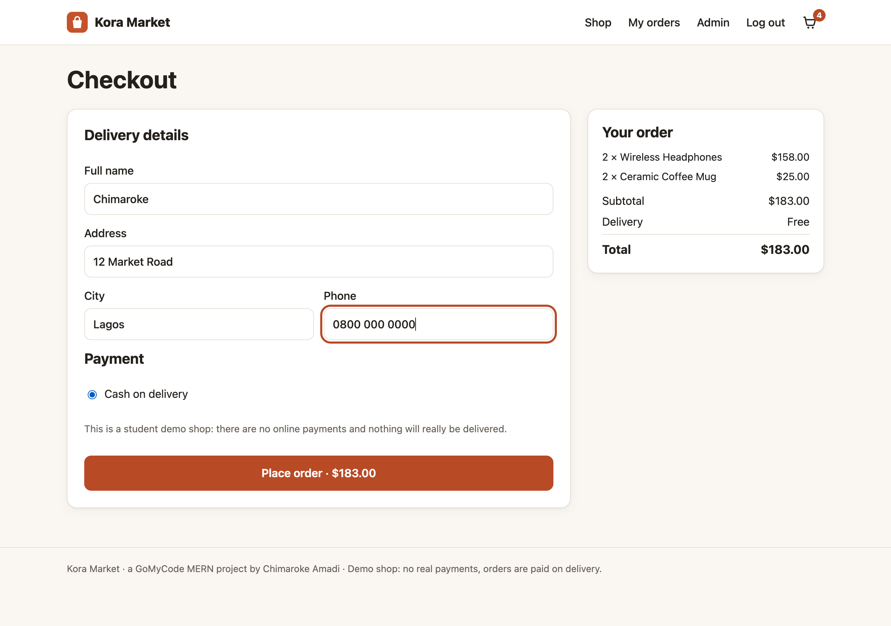
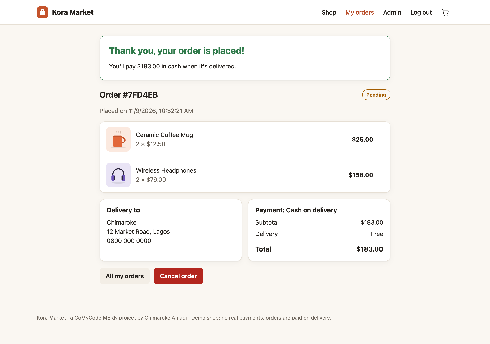
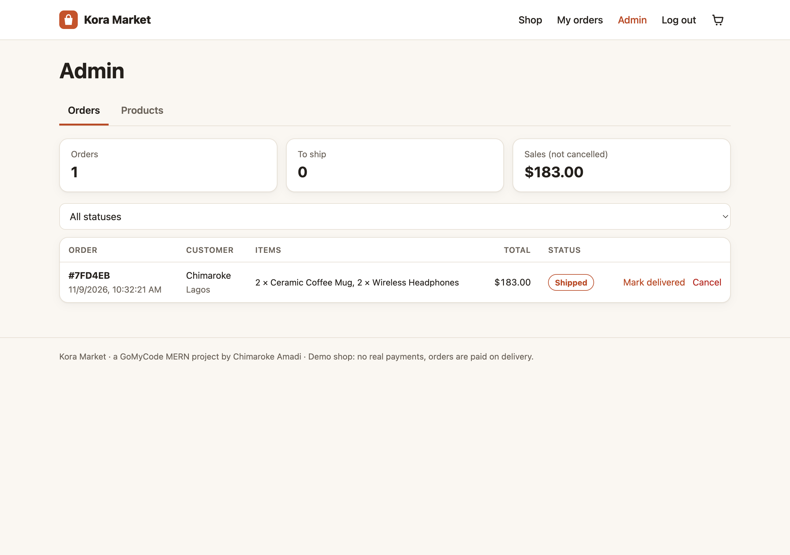
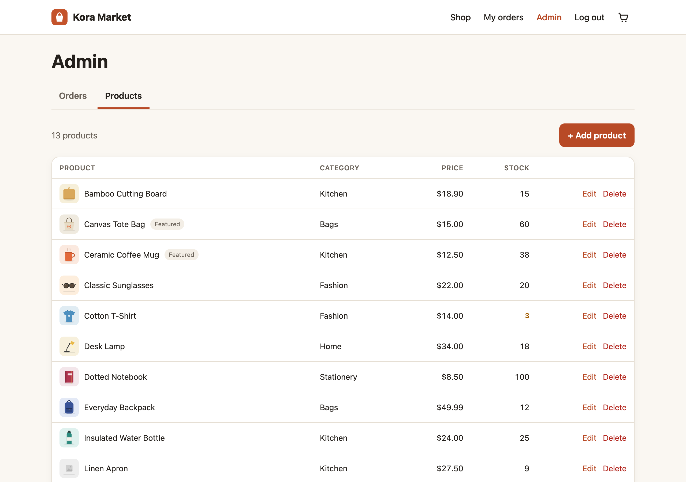
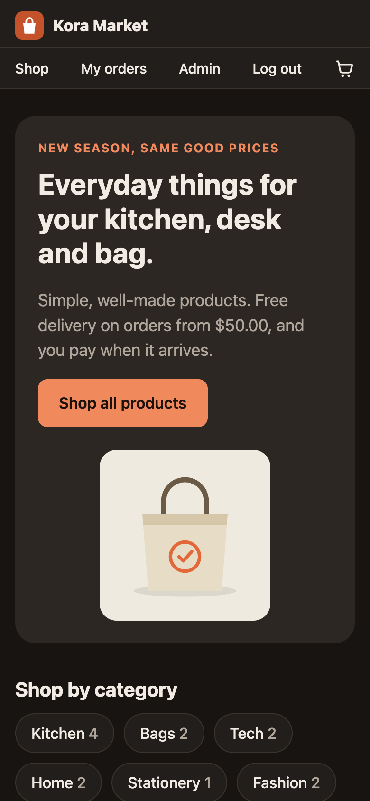

# Kora Market: Full E-Commerce Website (MERN)

**Live app:** https://chimaroke-kora-market-e9fycmh8a8fhdscc.westus3-01.azurewebsites.net

(It's on Azure's free plan, so if nobody visited for a while, the first page can take up to a minute to wake up.)

Kora Market is my full e-commerce website for the GoMyCode MERN track. It's a small shop that sells everyday things (mugs, bags, headphones, notebooks…). The frontend is React, the backend is Node.js with Express, and the data is stored in MongoDB Atlas through Mongoose. The whole thing runs as one app on Microsoft Azure App Service: Express answers the `/api` requests and also serves the built React site.



## What you can do on the site

As a customer, you can:
- browse the products, search them by name, filter by category, sort them by price or name, and go through the pages;
- open a product to see its description and how many are left in stock;
- add things to the cart, change the quantities and remove items (the cart is saved in the browser, so it's still there after a refresh);
- create an account or log in, then check out with your delivery address and see the order confirmation;
- see your past orders and cancel one while it hasn't been shipped yet.

The account whose email is set in `ADMIN_EMAIL` is the shop admin. The admin gets an **Admin** page where they can:
- add, edit and delete products and change the stock;
- see every order, mark it as shipped and then delivered, or cancel it.

The site has a light and a dark mode (it follows your phone or computer settings), and it works on phones.

There is no real payment: this is a student project, so the only payment method is "cash on delivery" and nothing actually gets sent. I didn't want to collect card details on a demo site.

## Things I paid attention to

The most important rule I followed is that **the browser is never trusted with prices**. When you place an order, the React app only sends the product ids and quantities. The server looks up the real prices in the database, adds the delivery fee (free from $50, otherwise $5) and saves a copy of each product's name and price inside the order. That way, changing a product's price later doesn't change old orders, and nobody can edit the price in the browser and pay less. One of my tests sends a fake price of $0.01 to check that it's ignored.

The second thing was **stock**. When an order is placed, each product's stock goes down with one MongoDB update that only works if `stock >= quantity`. If two people try to buy the last T-shirts at the same exact moment, only one of them gets them and the other one gets a clear "Only 1 left" message, so the shop never sells more than it has. I tested this by sending two orders at the same time. If one product in the cart is out of stock, the stock already taken for the other products is given back. Cancelling an order also puts the items back in stock.

For **accounts**, passwords are hashed with bcrypt and never sent back by the API. After login, the server gives a JSON Web Token that lasts 7 days, and the React app sends it with every request. A customer can only see their own orders: if you try to open someone else's order, you get "Order not found". Admin routes answer 403 to normal users.

## How it's built

```
server.js           Express app: API routes, error handling, serves the React build
seed.js             adds the 12 starter products when the database is empty
models/             Mongoose models: User, Product, Order
routes/             auth.js (register/login), products.js, orders.js
middleware/auth.js  checks the login token and the admin rights
data/products.js    the starter products
client/             the React app (Vite + React Router): pages, cart, login
public/             the built React app (made by npm run build:client)
scripts/            make-images.js (draws the product pictures), copy-to-azure-repo.sh
test/api.test.js    11 tests on the whole API
screenshots/        pictures of the site
```

The product pictures are simple SVG drawings that I made with `scripts/make-images.js`, so they're tiny, sharp on any screen, and I don't have to worry about copyright.

### The API

| Method | URL | What it does |
|---|---|---|
| POST | /api/auth/register | create an account |
| POST | /api/auth/login | log in, returns a token |
| GET | /api/auth/me | who am I (needs login) |
| GET | /api/products | list with `search`, `category`, `sort`, `page`, `limit`, `featured` |
| GET | /api/products/categories | categories with how many products each |
| GET | /api/products/:slug | one product |
| POST / PUT / DELETE | /api/products(/:id) | add, edit, delete (admin) |
| POST | /api/orders | place an order (needs login) |
| GET | /api/orders/mine | my orders |
| GET | /api/orders/:id | one order (mine, or any for the admin) |
| POST | /api/orders/:id/cancel | cancel my pending order |
| GET | /api/orders | all orders (admin) |
| PATCH | /api/orders/:id/status | shipped / delivered / cancelled (admin) |
| GET | /api/health | is the app up and connected to MongoDB |

## Running it on my computer

```bash
npm install
npm run build:client   # builds the React app into public/
npm run local          # starts the shop with a temporary in-memory MongoDB
npm test               # runs the 11 API tests
```

Then open http://localhost:3000. With `npm run local` you don't need MongoDB or a `.env` file, and to get the Admin page you register with `admin@kora.test`. All the data disappears when you stop it.

To run it against MongoDB Atlas instead, copy `config/.env.example` to `config/.env`, fill in `MONGO_URI`, `JWT_SECRET` and `ADMIN_EMAIL`, and run `npm start`. The `.env` file is in `.gitignore`, so the passwords never go to GitHub.

## Deployment on Azure

I deployed it the same way as my previous MERN checkpoint:
1. Build the React app with `npm run build:client`, so `public/` holds the site.
2. Create a Web App on Azure App Service (Linux, Node 22, the free F1 plan) and turn on Local Git in the Deployment Center.
3. Add the environment variables `MONGO_URI` (Atlas, database `ecommerce`), `JWT_SECRET` and `ADMIN_EMAIL` in the Web App settings.
4. Clone the Azure Git repo, copy the app into it with `sh scripts/copy-to-azure-repo.sh <folder>`, then commit and push. Azure installs the packages and starts `npm start`.

The first time the app connects to the empty Atlas database, it adds the 12 starter products by itself, so the shop isn't empty.

The hardest part for me was the Git login: the Deployment Center page showed the credentials as "REDACTED" and greyed out. I got the deployment password with the Azure Cloud Shell (`az webapp deployment list-publishing-credentials`) and cloned with the username `$<app name>` in the URL. After the push, Azure's build (Oryx) ran `npm install` and the deployment succeeded.



## Screenshots

| | |
|---|---|
|  |  |
|  |  |
|  |  |
|  |  |
