# Library Management System: Analysis and Design

This document is my analysis and design of a simplified Library Management System. The goal isn't to build the whole system, but to understand what it needs to do, break it into parts, and model its structure and behaviour before writing the real code. At the end there are small code examples that show how the models turn into classes. The working versions are in the [`code`](code) folder.

All the diagrams are written in Mermaid, which GitHub and VS Code (with a Mermaid extension) draw automatically. They can also be seen in the browser by opening [`diagrams.html`](diagrams.html).

## Contents

1. [Requirement analysis](#1-requirement-analysis)
2. [Use case diagram](#2-use-case-diagram)
3. [System architecture](#3-system-architecture)
4. [Class diagram](#4-class-diagram)
5. [Sequence diagrams](#5-sequence-diagrams)
6. [State diagram for a Book](#6-state-diagram-for-a-book)
7. [Data model](#7-data-model)
8. [Functional model](#8-functional-model)
9. [Behavioural model](#9-behavioural-model)
10. [From abstraction to implementation](#10-from-abstraction-to-implementation)
11. [Design principles I followed](#11-design-principles-i-followed)

---

## 1. Requirement analysis

### What the system is for

A small library (like a school or community library) wants to replace its paper records. The system should keep a catalogue of books, keep track of the members, record who borrows what and when it's due back, charge fines for late returns, and let staff manage all of this.

### Actors

An actor is anyone (or anything) outside the system that uses it.

| Actor | Who it is | What they mainly do |
|---|---|---|
| **Member** | A registered reader (student, teacher or the public) | Searches the catalogue, reserves books, sees their loans, pays fines |
| **Librarian** | Library staff at the desk | Issues and returns books, registers members, adds and updates books |
| **Administrator** | The person in charge of the system | Manages librarian accounts, sets the rules (loan period, fine per day), sees reports |
| **Scheduler** (system timer) | A job that runs automatically every night | Finds overdue loans, updates fines, sends reminders |
| **Email service** (external) | An outside service like SendGrid | Delivers the reminder and confirmation emails |

The Administrator is a special kind of Librarian, so they can do everything a librarian can do, plus the admin tasks.

### Functional requirements

1. Anyone can search the catalogue by title, author, ISBN or category.
2. Members must log in to reserve books, see their loans, renew a loan or pay a fine.
3. A librarian can issue a book to a member, if the book is available and the member is allowed to borrow (account active, under their book limit, no unpaid fines over the limit).
4. A librarian can record a return. If it's late, a fine is calculated automatically.
5. A member can reserve a book that is currently issued. When it comes back, it's held for them and they're notified.
6. A member can renew a loan once, if nobody has reserved the book.
7. Librarians can add, edit and remove books, and register, update or suspend members.
8. The system checks for overdue loans every day and emails the members.
9. The administrator can change the library rules and view reports (most borrowed books, overdue loans, fines collected).

### Non-functional requirements

- **Security:** passwords are stored hashed, and each role only sees the actions it's allowed to do.
- **Usability:** issuing or returning a book should take only a few clicks or a barcode scan.
- **Reliability:** a book can never be issued to two people at once (checked inside a database transaction).
- **Maintainability:** the code is split into layers, so changing the database or the user interface doesn't affect the business rules.

### Key use cases

| ID | Use case | Main actor | Short description |
|---|---|---|---|
| UC1 | Search book | Member, Librarian | Find books by title, author, ISBN or category |
| UC2 | Log in | Member, Librarian | Prove who you are before using protected features |
| UC3 | Issue book | Librarian | Lend an available book to a member and set the due date |
| UC4 | Return book | Librarian | Record a book coming back, calculate a fine if late |
| UC5 | Reserve book | Member | Join the waiting list for a book that's out |
| UC6 | Renew loan | Member | Extend a loan's due date once |
| UC7 | View my loans | Member | See current loans, due dates and fines |
| UC8 | Pay fine | Member | Pay what's owed |
| UC9 | Manage books | Librarian | Add, edit, remove, mark as lost or damaged |
| UC10 | Manage members | Librarian | Register, update, suspend members |
| UC11 | Manage staff and rules | Administrator | Librarian accounts, loan period, fine rate |
| UC12 | View reports | Administrator | Statistics about loans and fines |
| UC13 | Check overdue loans | Scheduler | Daily job: mark overdue loans, add fines, send reminders |

---

## 2. Use case diagram

Mermaid doesn't have a real UML use case diagram, so I drew it as a flowchart. The actors are on the outside, the use cases (the rounded shapes) are inside the system boundary, and the dotted arrows are the `include` and `extend` relationships. **Include** means the use case always needs the other one (you always have to log in to reserve a book). **Extend** means it only happens sometimes (paying a fine only happens when the return is late).

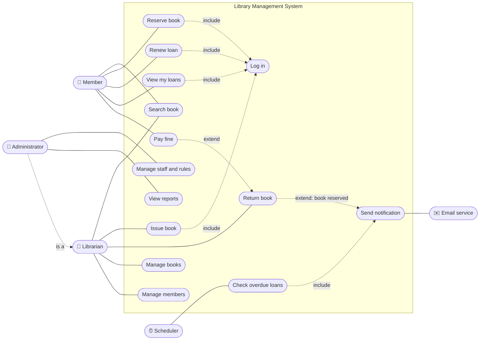

### Use case description: Issue book (UC3)

| | |
|---|---|
| **Actor** | Librarian |
| **Precondition** | The librarian is logged in |
| **Main flow** | 1. The librarian scans the member card and the book barcode. 2. The system checks the member is active, under their limit, and has no blocking fines. 3. The system checks the book is available, or reserved for this member. 4. The system creates a loan with a due date (today + the loan period for that member type). 5. The book's status changes to *Issued*. 6. The system shows the due date and sends a confirmation email. |
| **Alternative flows** | 2a. The member can't borrow: the system shows the reason and stops. 3a. The book is issued or reserved for someone else: the system offers to reserve it for the member instead. |
| **Postcondition** | One new open loan exists, and the book is *Issued* |

### Use case description: Return book (UC4)

| | |
|---|---|
| **Actor** | Librarian |
| **Precondition** | The book has an open loan |
| **Main flow** | 1. The librarian scans the book. 2. The system finds the open loan and records the return date. 3. If the book is late, the system creates a fine (days late × fine per day). 4. The librarian checks the condition of the book. 5. If someone has reserved it, the book becomes *Reserved* for them and they're notified. Otherwise it becomes *Available*. |
| **Alternative flows** | 4a. The book is damaged: its status becomes *Damaged* and a damage fine can be added. |
| **Postcondition** | The loan is closed, and the book is Available, Reserved or Damaged |

---

## 3. System architecture

I chose a **layered architecture**. Each layer only talks to the layer right under it. That way the business rules (the most important part) don't depend on how the screens look or which database is used.

| Layer | Responsibility | Parts |
|---|---|---|
| **Presentation (UI)** | What people see and click. No business rules here. | Member web portal, librarian desk app, admin dashboard |
| **API / Controllers** | Receives requests, checks who is logged in and what role they have, calls the right service | `AuthController`, `BookController`, `LoanController`, `MemberController`, `AdminController` |
| **Business logic (services)** | All the rules: can this member borrow? how much is the fine? | `CatalogService`, `LoanService`, `MemberService`, `ReservationService`, `FineService`, `NotificationService`, `AuthService` |
| **Domain model** | The objects themselves and their own small rules | `Book`, `Member`, `Librarian`, `Loan`, `Reservation`, `Fine` |
| **Data access (repositories)** | Saves and loads objects. Only this layer knows SQL. | `BookRepository`, `MemberRepository`, `LoanRepository`, … |
| **Database / external** | Where the data lives, outside services | PostgreSQL database, email service |

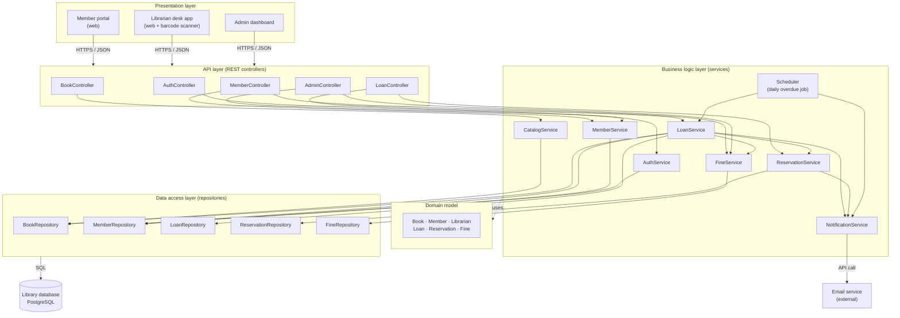

**An example of how the layers work together:** when a librarian issues a book, the desk app sends `POST /loans` to the `LoanController`. The controller checks the librarian is logged in and passes the member id and book id to `LoanService.issueBook()`. The service loads the `Member` and the `Book` through the repositories, asks them `member.canBorrow()` and `book.isAvailable()`, creates a `Loan`, saves everything, and asks the `NotificationService` to send a confirmation email. The answer goes back up the same way to the screen.

---

## 4. Class diagram

I found the classes by looking at the nouns in the use cases (book, member, loan, reservation, fine, librarian) and the methods by looking at the verbs (issue, return, reserve, renew, pay). I kept the services separate from the domain classes, so each class has a single job. A `Book` knows its own status, but deciding whether a loan can happen is the `LoanService`'s job, because it needs both the book and the member.

`-` means private, `+` means public, and `#` means protected.

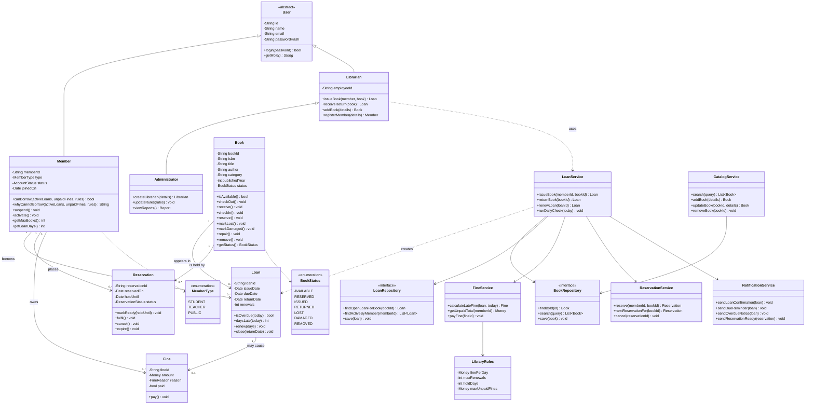

**Notes on the class design:**

- **`User` is abstract**, because there's no such thing as a "plain" user. Everyone is a Member, a Librarian or an Administrator. `getRole()` (marked with `*`) is abstract.
- **A `Book` here is one physical copy.** If the library has three copies of the same title, there are three `Book` objects with the same ISBN. A bigger system would split this into `BookTitle` and `BookCopy`, but for this size one class is enough.
- **Book's status can only change through its methods** (`checkOut()`, `checkIn()`, …), and each method checks that the change is allowed (see the state diagram). Nobody can just write `book.status = "ISSUED"`.
- **The repositories are interfaces**, so the services don't care if the data is in PostgreSQL, a file, or in memory (which is what I used in the code examples).

---

## 5. Sequence diagrams

A sequence diagram shows which object talks to which, in order, for one use case.

### 5.1 Issue book (UC3)

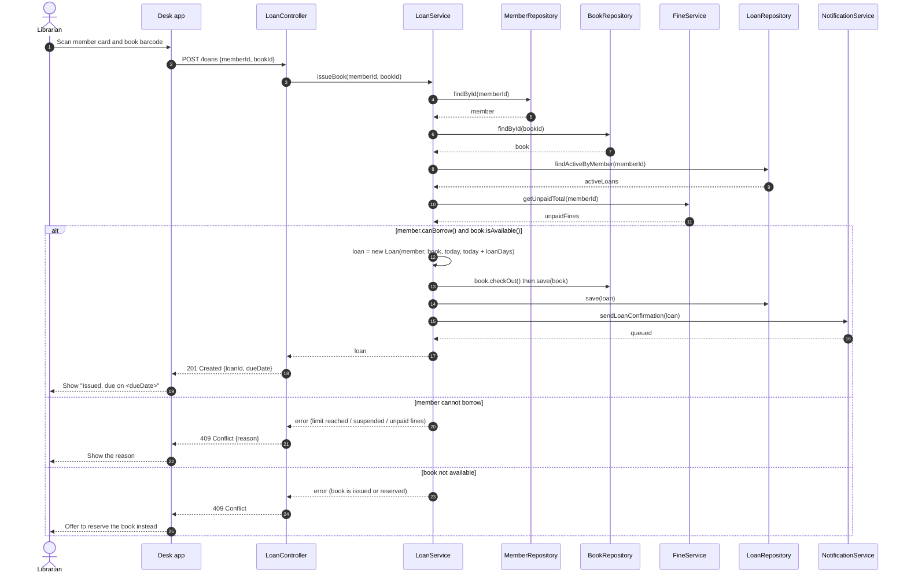

### 5.2 Return book (UC4)

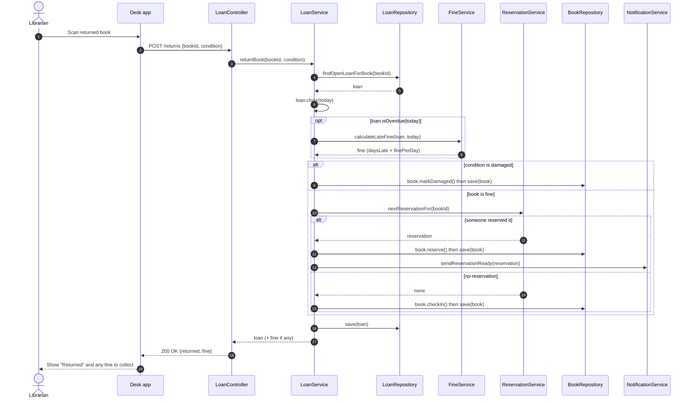

### 5.3 Search book (UC1)

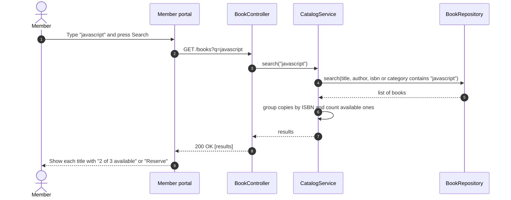

---

## 6. State diagram for a Book

The status of a book changes over its life. The state diagram shows every status it can have and the events that move it from one to another. Any change that isn't drawn here is not allowed, and the `Book` class refuses it (for example, you can't issue a book that is *Lost*).

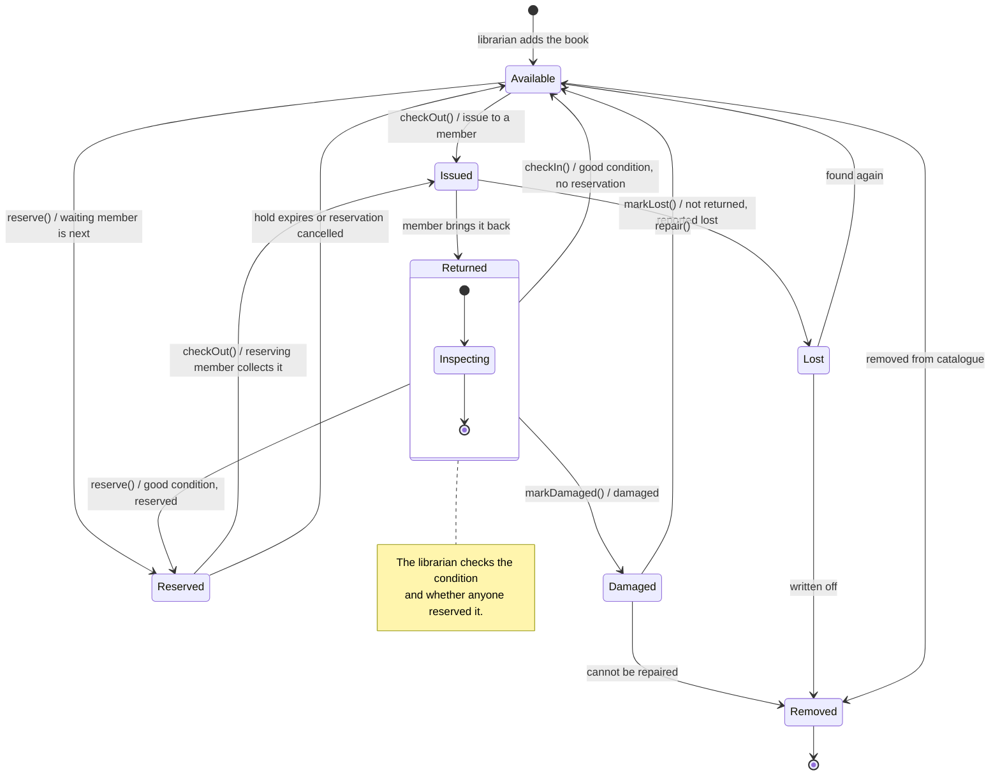

*Overdue* isn't a separate status of the book. It's a property of the **loan** (the book is still *Issued*, it's just late), which is why it appears in the loan's state diagram in section 9 instead.

---

## 7. Data model

The data model shows how the information is stored. I turned the classes into database tables. Each table has a primary key (PK), and the relationships use foreign keys (FK). The `users` table holds what all users share, and members and librarians each have their own extra table. This is how inheritance is usually stored in a relational database.

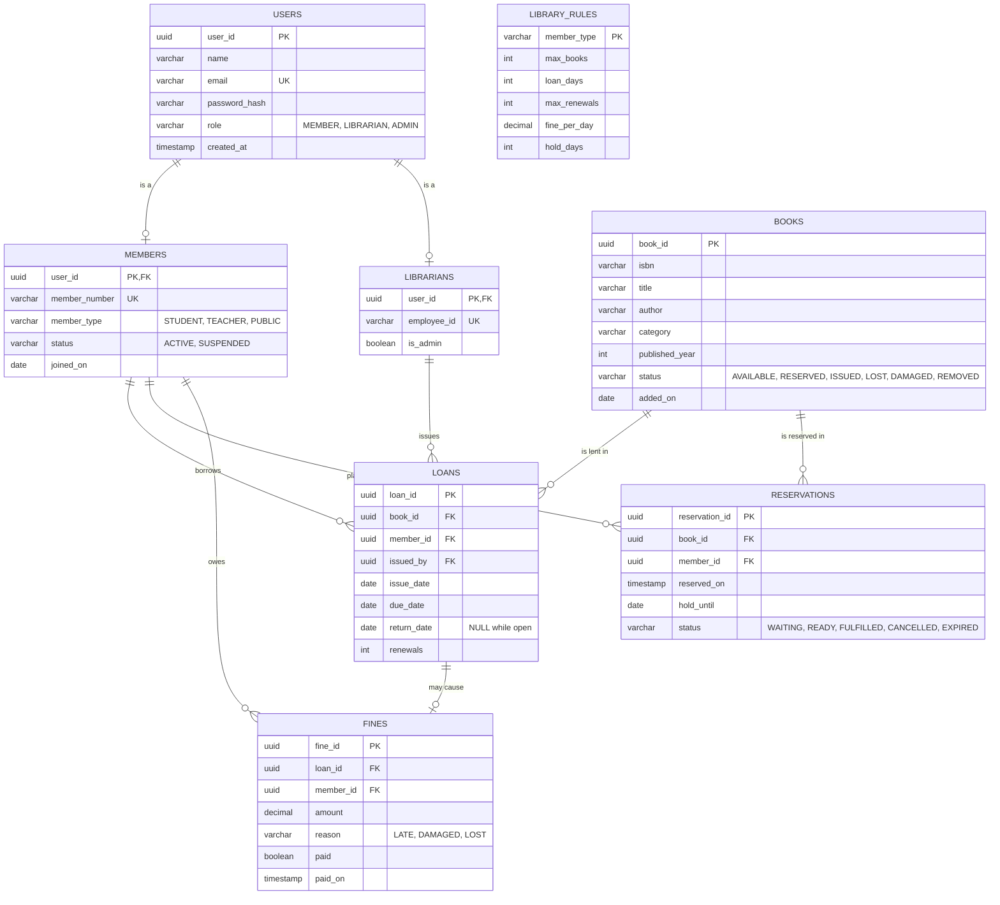

**A few rules the database enforces:**

- `users.email`, `members.member_number` and `librarians.employee_id` are unique (UK).
- A book can only have **one open loan** (`return_date IS NULL`) at a time. In PostgreSQL this can be a partial unique index: `CREATE UNIQUE INDEX one_open_loan ON loans(book_id) WHERE return_date IS NULL;`. This is what guarantees the "never issued to two people" requirement, even if two librarians click at the same moment.
- `fines.amount` must be greater than 0, and `loans.due_date` must be after `issue_date` (CHECK constraints).
- The rules (loan days, fine per day, …) are stored in `library_rules` instead of being written into the code, so the administrator can change them without a new release.

---

## 8. Functional model

The functional model shows **what the system does with data**: what comes in, which process handles it, and where it's stored. I used Data Flow Diagrams (DFDs).

### Level 0 (context diagram)

The whole system is one process, and you only see what goes in and out.

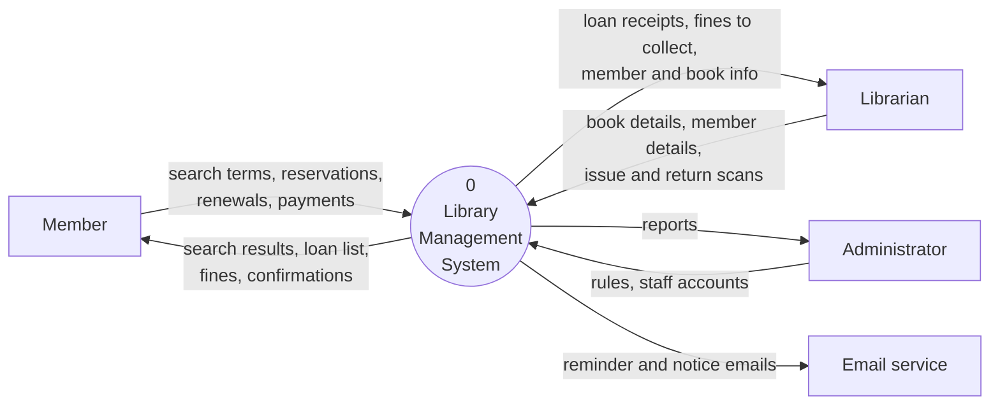

### Level 1

Here the system is split into its main processes and data stores (the database tables).

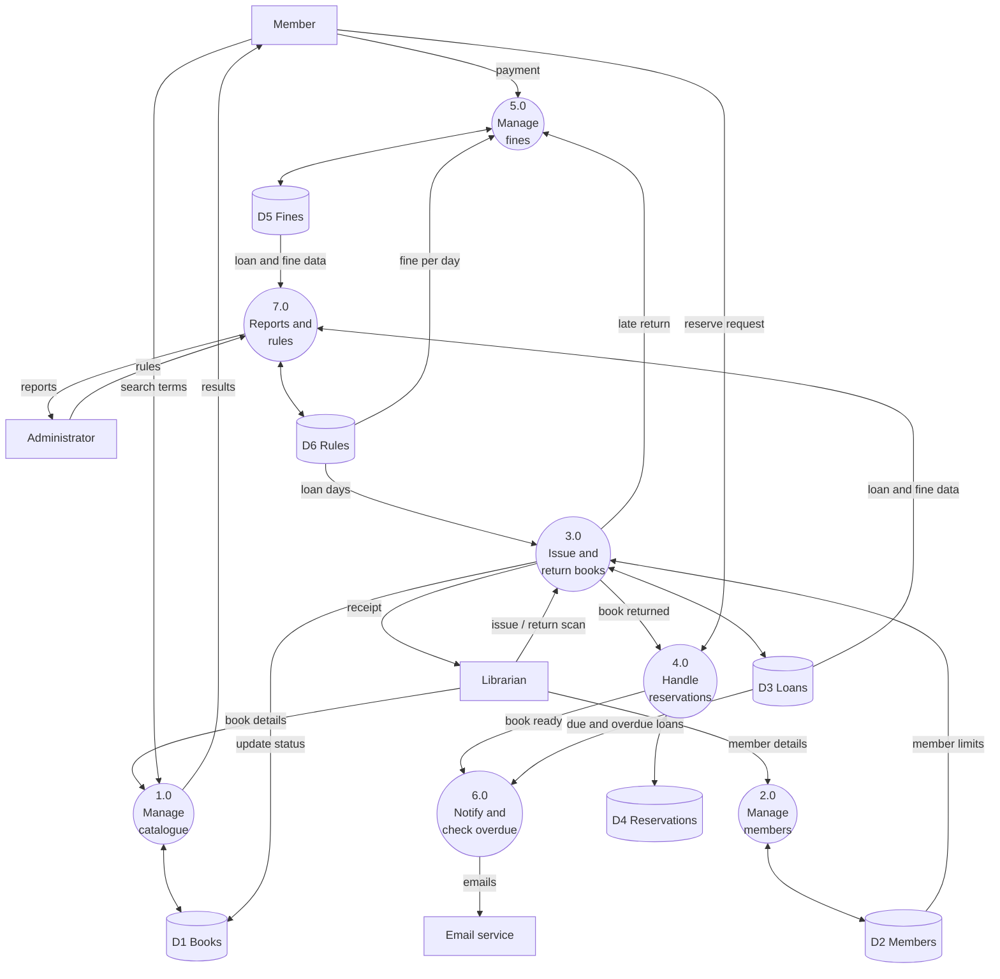

---

## 9. Behavioural model

The behavioural model shows how the system behaves **over time**: how objects change state and the order in which things happen. The book's state diagram in section 6 is the main part of it. Here are two more.

### Loan state diagram

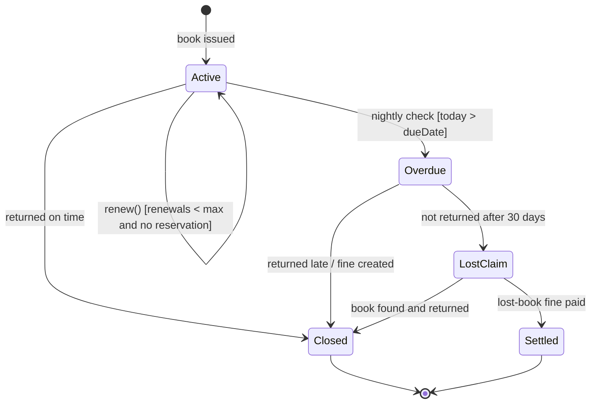

### Activity diagram: daily overdue check (UC13)

This is what the Scheduler does every night. It shows the decisions and the loop.

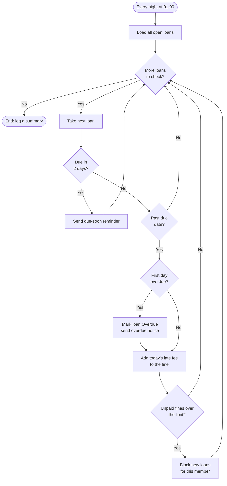

---

## 10. From abstraction to implementation

This section shows how the models above become code. I wrote the snippets in JavaScript. The full, runnable versions are in the [`code`](code) folder (`node code/demo.js`), and they use the in-memory repositories in place of a real database.

### Book: the state diagram as code

The allowed moves from the state diagram are written down as a table. Every method goes through one private `#moveTo()` method that refuses any move that isn't in the table. That way the state diagram and the class can't disagree.

```js
export const BookStatus = Object.freeze({
  AVAILABLE: 'AVAILABLE', RESERVED: 'RESERVED', ISSUED: 'ISSUED',
  RETURNED: 'RETURNED', DAMAGED: 'DAMAGED', LOST: 'LOST', REMOVED: 'REMOVED',
});

// Straight from the state diagram: from -> the statuses it can go to
const ALLOWED = {
  AVAILABLE: ['ISSUED', 'RESERVED', 'REMOVED'],
  RESERVED:  ['ISSUED', 'AVAILABLE'],
  ISSUED:    ['RETURNED', 'LOST'],
  RETURNED:  ['AVAILABLE', 'RESERVED', 'DAMAGED'],
  DAMAGED:   ['AVAILABLE', 'REMOVED'],
  LOST:      ['AVAILABLE', 'REMOVED'],
  REMOVED:   [],
};

export class Book {
  #status = BookStatus.AVAILABLE;   // private: only changes through methods

  constructor({ bookId, isbn, title, author, category }) {
    Object.assign(this, { bookId, isbn, title, author, category });
  }

  get status()  { return this.#status; }
  isAvailable() { return this.#status === BookStatus.AVAILABLE; }

  checkOut()    { this.#moveTo(BookStatus.ISSUED); }
  receive()     { this.#moveTo(BookStatus.RETURNED); }
  checkIn()     { this.#moveTo(BookStatus.AVAILABLE); }
  reserve()     { this.#moveTo(BookStatus.RESERVED); }
  markDamaged() { this.#moveTo(BookStatus.DAMAGED); }
  markLost()    { this.#moveTo(BookStatus.LOST); }

  #moveTo(next) {
    if (!ALLOWED[this.#status].includes(next)) {
      throw new Error(`Cannot go from ${this.#status} to ${next}`);
    }
    this.#status = next;
  }
}
```

### LoanService.issueBook: the sequence diagram as code

Each line matches a step in sequence diagram 5.1. (This is a shortened version. The one in `code/services.js` also lets a member collect a book that's being held for them.)

```js
issueBook(memberId, bookId, today = new Date()) {
  const member = this.members.findById(memberId);            // steps 4-5
  const book = this.books.findById(bookId);                  // steps 6-7
  const activeLoans = this.loans.findActiveByMember(memberId); // steps 8-9
  const unpaid = this.fineService.getUnpaidTotal(memberId);  // steps 10-11

  const reason = member.whyCannotBorrow(activeLoans.length, unpaid, this.rules);
  if (reason) throw new LoanError(reason);                   // "member cannot borrow"
  if (!book.isAvailable()) throw new LoanError(`"${book.title}" is ${book.status}`);

  const loan = new Loan({ book, member, issueDate: today,
                          loanDays: this.rules.loanDaysFor(member.type) });
  book.checkOut();                                           // Available -> Issued
  this.books.save(book);
  this.loans.save(loan);
  this.notifier.sendLoanConfirmation(loan);
  return loan;
}
```

### Pseudocode: returning a book (sequence diagram 5.2)

```
FUNCTION returnBook(bookId, condition, today)
    loan ← loanRepository.findOpenLoanForBook(bookId)
    IF loan IS NONE THEN
        RAISE "This book is not on loan"
    END IF

    loan.close(today)
    book ← loan.book
    book.receive()                                // Issued → Returned
    fine ← NONE

    IF loan.isOverdue(today) THEN
        fine ← NEW Fine(loan, loan.daysLate(today) × rules.finePerDay, LATE)
        fineRepository.save(fine)
    END IF

    IF condition = DAMAGED THEN
        book.markDamaged()                        // Returned → Damaged
    ELSE
        reservation ← reservationService.nextReservationFor(bookId)
        IF reservation EXISTS THEN
            book.reserve()                        // Returned → Reserved
            reservation.markReady(today + rules.holdDays)
            notificationService.sendReservationReady(reservation)
        ELSE
            book.checkIn()                        // Returned → Available
        END IF
    END IF

    bookRepository.save(book)
    loanRepository.save(loan)
    RETURN loan, fine
END FUNCTION
```

---

## 11. Design principles I followed

- **Single responsibility:** each class has one reason to change. `Book` only manages its own data and status. `FineService` is the only place that knows how fines are calculated. Repositories are the only classes that know about storage.
- **Encapsulation:** important data like a book's status or a loan's return date is private, and it can only change through methods that check the rules first.
- **Abstraction:** `User` is abstract, and the repositories are interfaces. The services depend on "something that can find a book", not on PostgreSQL.
- **Inheritance and polymorphism:** `Member`, `Librarian` and `Administrator` share what's in `User`. Loan days and book limits depend on the member type, so the loan code doesn't need `if student … else if teacher …` everywhere.
- **Separation of concerns:** the layered architecture keeps the screens, the rules and the data apart, so each part can be changed or tested on its own.
- **Configurable rules:** fines, loan periods and limits are data (`LibraryRules`), not numbers hidden in the code.
