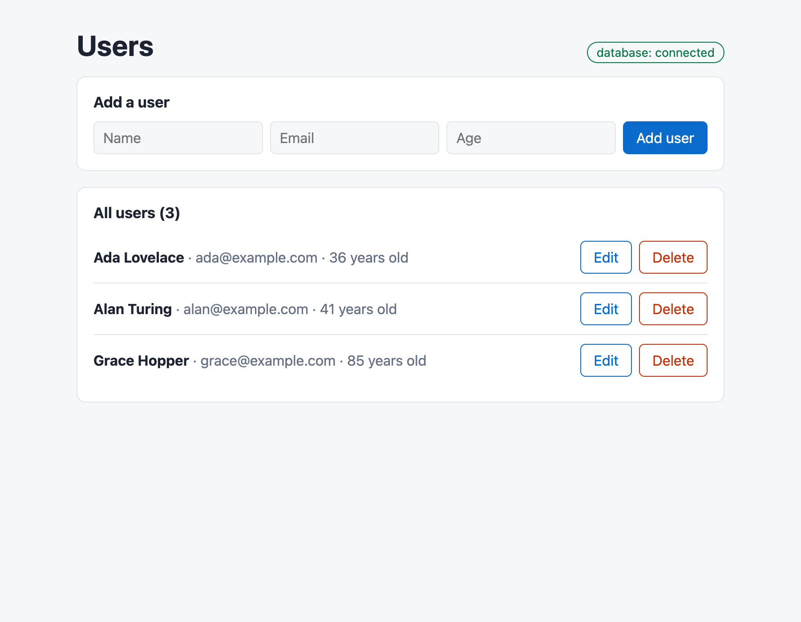
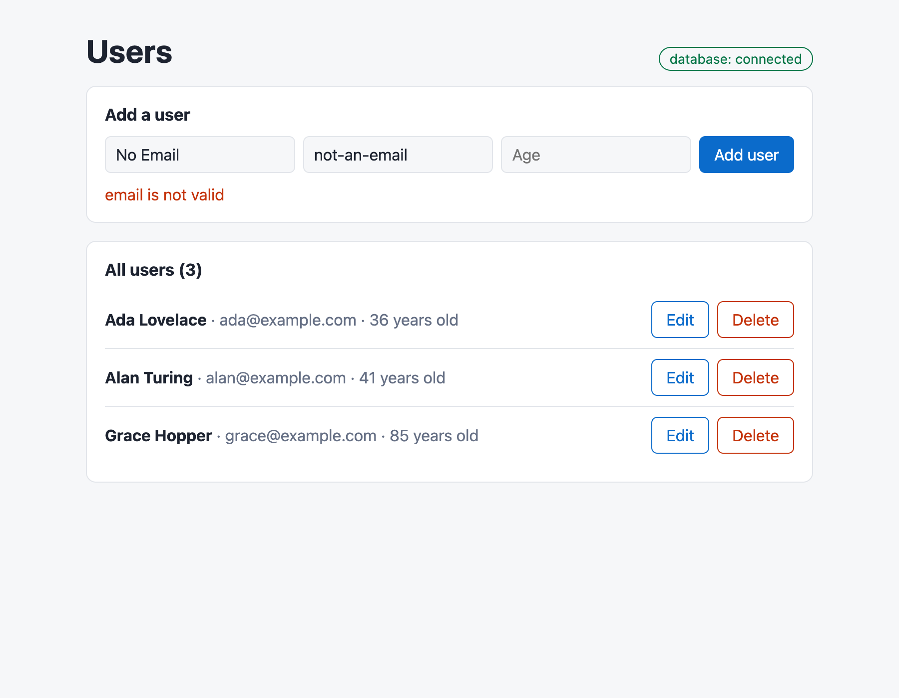
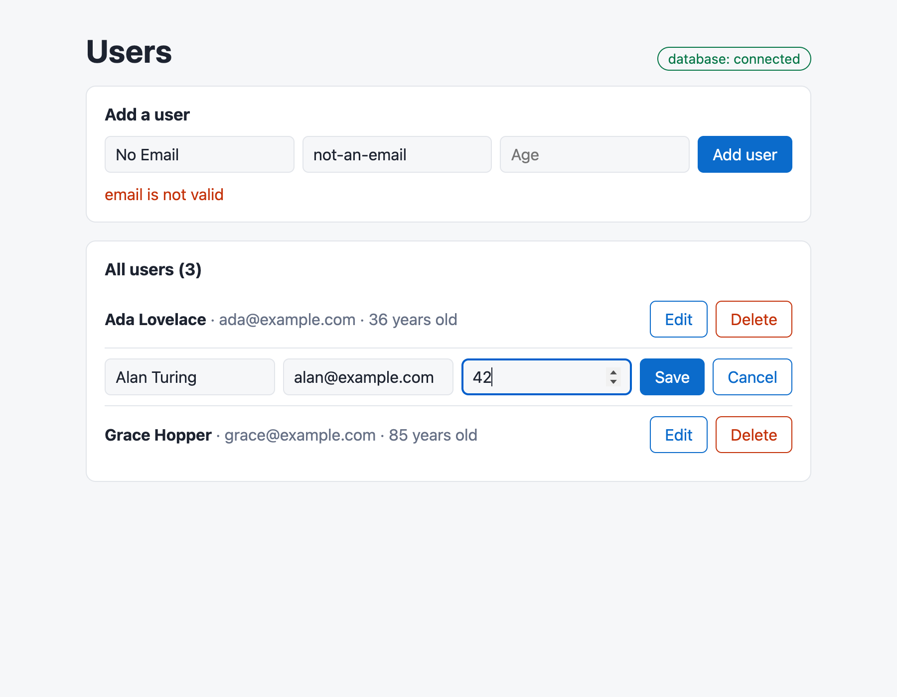
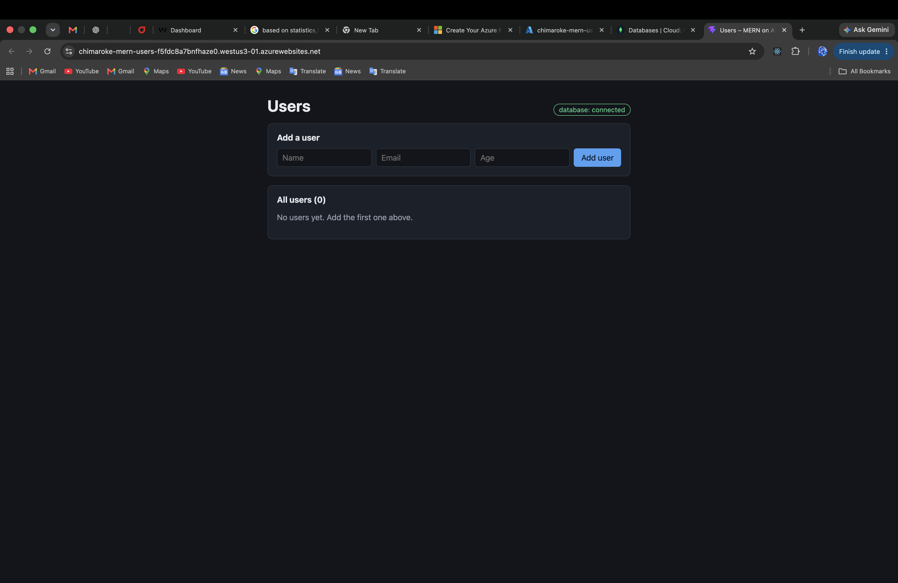
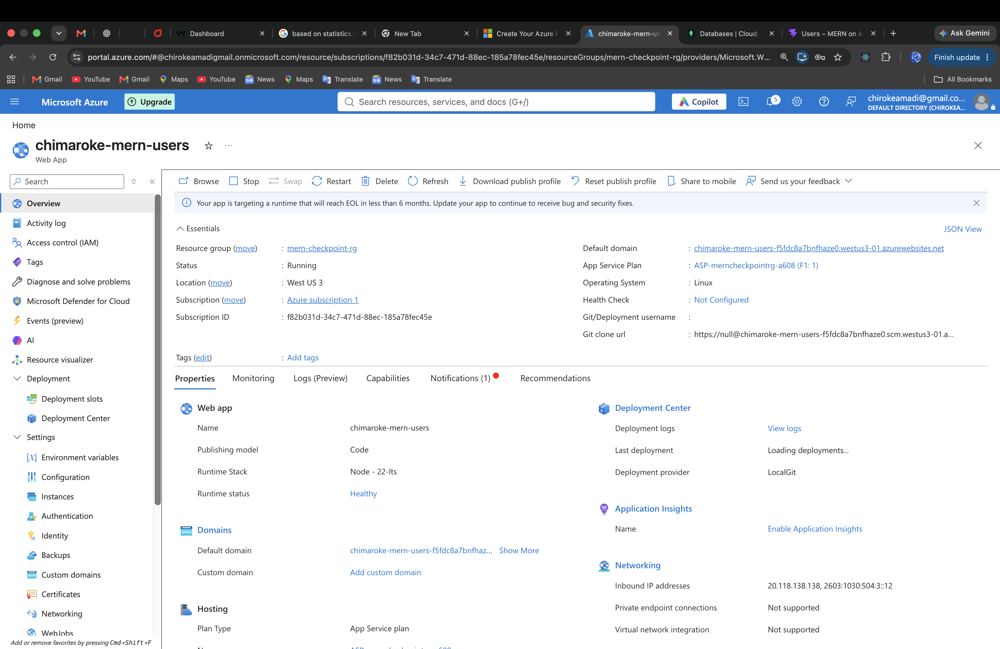
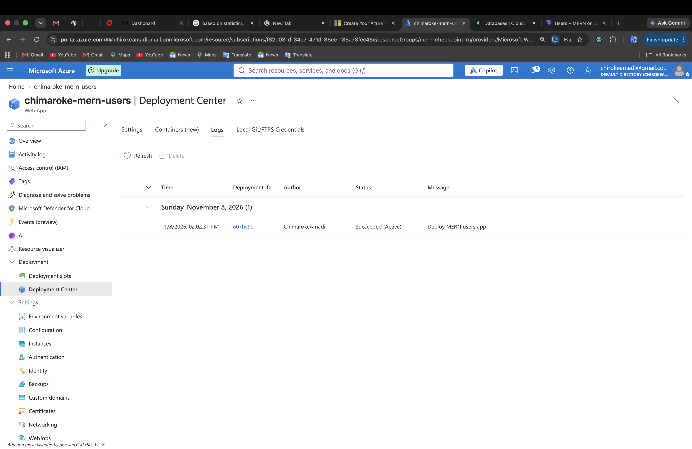
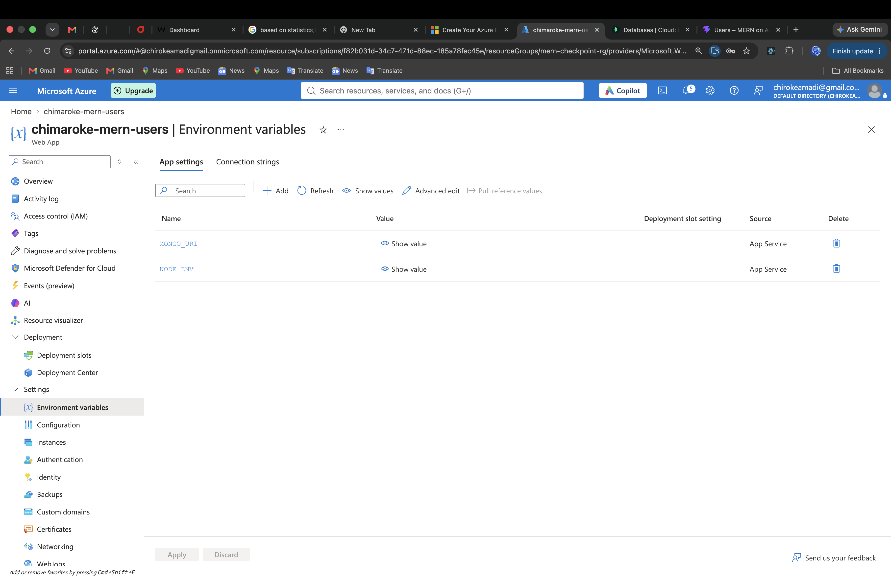
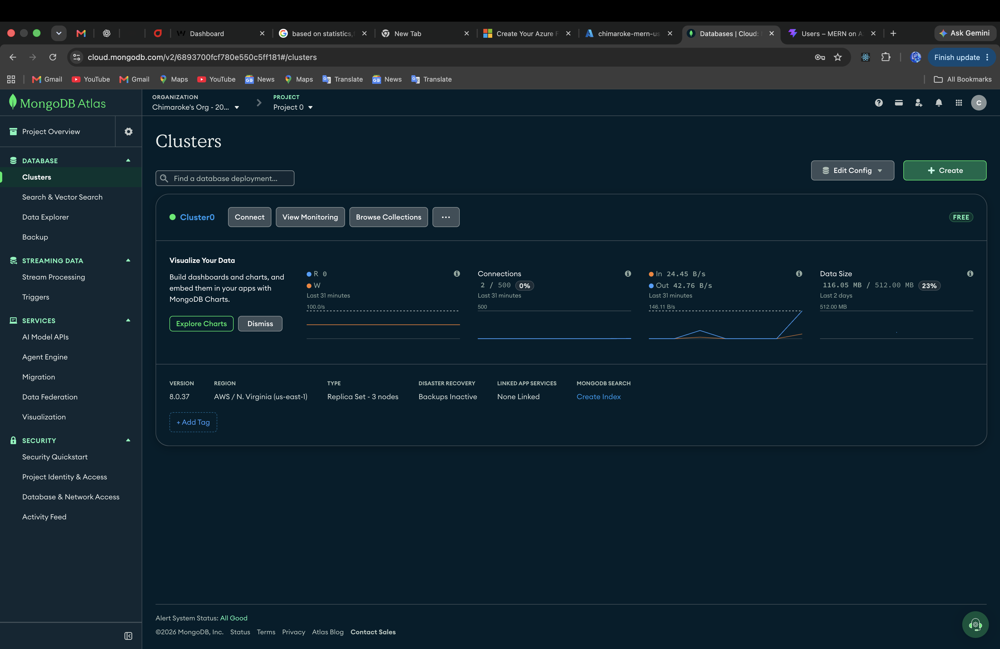

# Hosting a MERN App on Microsoft Azure

For this checkpoint I prepared a full MERN app (MongoDB, Express, React, Node)
and deployed it to an **Azure Web App**, with the database on **MongoDB Atlas**.
The app manages a list of users: you can add, edit and delete them, and
everything is saved in MongoDB.

**Live app:**
https://chimaroke-mern-users-f5fdc8a7bnfhaze0.westus3-01.azurewebsites.net

The backend is my Users API from the Mongoose checkpoint, copied here and moved
under `/api`. I added a React frontend made with Vite. In production, Express
serves the built React files too, so the whole app runs as **one** Azure Web App
on one URL.

```
server.js                     Express: the /api routes + serves the React build from public/
models/User.js                the Mongoose schema
config/.env.example           the environment variables the app needs (the real .env is not committed)
public/                       the BUILT React app (made by "npm run build:client")
client/                       the React source code (Vite)
scripts/copy-to-azure-repo.sh copies only the files Azure needs into the Azure Git repo
scripts/check-deployment.js   tests a deployed copy of the app from the outside
test/                         automated tests
screenshots/                  the app running
local.js                      runs the app with a temporary in-memory MongoDB
```

## 1. Running and testing it locally

```bash
npm install
npm run build:client      # builds React into public/
npm run local             # http://localhost:3000 with a temporary MongoDB
npm test                  # 9 automated tests
```

To work on the React code with hot reload, run `npm run local` in one terminal
and `npm run dev:client` in another. Vite forwards the `/api` calls to Express.

I tested it at three levels:

- **Automated tests (`npm test`).** There are 9 tests. They check every API
  route and its errors (400, 404, 409), that the React page is served, and that
  a page refresh on any URL still gets the app. They also check that if the
  database is down, the API answers 503 right away instead of hanging.
- **The real browser.** I clicked through the app with a headless Chrome. I
  added 3 users, tried an invalid email, edited one user and deleted one. After
  reloading the page, the data was still there. The pictures are in
  `screenshots/`.
- **A pretend deployment.** I copied only the files that go to Azure into an
  empty folder and installed them the way Azure does
  (`NODE_ENV=production npm install`). Then I started the app with `npm start`,
  using only environment variables (no `.env` file) and a real `mongod`.
  `scripts/check-deployment.js` passed all its checks against it.

| Users list                        | Validation error                        | Editing                        |
| --------------------------------- | --------------------------------------- | ------------------------------ |
|  |  |  |

## 2. What I changed to make it ready for deployment

- **No secrets in the code.** The database address comes from
  `process.env.MONGO_URI`. On my computer, it is read from `config/.env`, which
  is in `.gitignore`. On Azure, it comes from the Web App's environment
  variables.
- **The port comes from Azure.** Azure tells the app which port to use through
  `PORT`, so the server does `app.listen(process.env.PORT || 3000)`.
- **The API is under `/api`.** Everything else gets the React app. Express
  serves `public/`, and any other URL returns `index.html`, so refreshing a page
  doesn't give a 404.
- **The React build goes straight into the backend.** `vite.config.js` has
  `outDir: '../public'`, so `npm run build:client` does the "copy the build into
  the backend project" step for me.
- **A health check.** `GET /api/health` returns `{"database":"connected"}` when
  MongoDB is reachable, and the page shows it as a badge. If Atlas refuses the
  connection, the app keeps running and retries every 10 seconds instead of
  crashing. This made it much easier to see what was wrong.
- **There is no `build` script in the root `package.json`, on purpose.** Azure's
  build system runs `npm run build` if it finds one. My React build needs the
  client's packages, which Azure doesn't install, so I named it `build:client`
  and commit the built `public/` folder instead.

## 3. MongoDB Atlas (the database)

1. Sign up at [mongodb.com/atlas](https://www.mongodb.com/cloud/atlas/register)
   and create a free **M0** cluster. A region close to the Azure region you'll
   use is best.
2. **Database Access → Add New Database User:** choose a username and a
   password. Use letters and numbers only, so you don't need to URL-encode it.
3. **Network Access → Add IP Address:** Atlas blocks every IP by default. The
   easy option is `0.0.0.0/0` (allow from anywhere). The safer option is to add
   only your Web App's outbound IPs, which are listed in Azure under **Web App →
   Networking → Outbound addresses**.
4. **Connect → Drivers:** copy the connection string and add the database name
   `users_api` after `.net/`:
   ```
   mongodb+srv://<user>:<password>@<cluster>.mongodb.net/users_api?retryWrites=true&w=majority
   ```
   To try it locally first, put it in `config/.env` as `MONGO_URI=...` and run
   `npm start`.

## 4. Azure Web App

1. Create an account at
   [azure.microsoft.com/free](https://azure.microsoft.com/free) and open the
   [Azure Portal](https://portal.azure.com).
2. **Create a resource → Web → Web App**, then fill in:
   - **Resource group:** a new one, e.g. `mern-checkpoint-rg`
   - **Name:** unique, e.g. `chimaroke-mern-users`, which becomes
     `https://chimaroke-mern-users.azurewebsites.net` (Azure may add a few extra
     characters to the address)
   - **Publish:** Code. **Runtime stack:** Node 22 LTS. **Operating system:**
     Linux
   - **Region:** one near you
   - **Pricing plan:** **Free F1** is enough for a checkpoint
3. **Review + create → Create**, then open the resource.

## 5. Environment variables

Go to **Web App → Settings → Environment variables** (older portals call it
**Configuration → Application settings**) and add:

| Name        | Value                                                          |
| ----------- | -------------------------------------------------------------- |
| `MONGO_URI` | the Atlas connection string from step 3                        |
| `NODE_ENV`  | `production` (so Azure doesn't install the test-only packages) |

Click **Apply**. The app restarts with the new values. I don't set `PORT`,
because Azure sets it itself.

## 6. Deploying with Local Git

1. **Turn on basic auth.** Go to **Configuration → General settings** and set
   **SCM Basic Auth Publishing Credentials** to **On**. New apps have it off,
   and Local Git needs it.
2. **Deployment Center → Source: Local Git → Save.** Azure shows a **Git Clone
   Uri**. On the **Local Git/FTPS credentials** tab, you get a username (it
   starts with `$`) and a password.
3. Clone the Azure repo into your home folder, copy the app into it, and push. I keep it outside my checkpoints repo so it doesn't get mixed in with the code on GitHub:

   ```bash
   git clone https://<your-app>.scm.azurewebsites.net:443/<your-app>.git ~/azure-mern-users
   npm run build:client                         # fresh React build in public/
   sh scripts/copy-to-azure-repo.sh ~/azure-mern-users
   cd ~/azure-mern-users
   git add -A
   git commit -m "Deploy MERN users app"
   git push origin HEAD:master                  # Azure deploys from "master"
   ```

   The push output shows Azure installing the packages ("Running 'npm
   install'...") and ends with "Deployment successful". Azure starts the app
   with `npm start`.

   The copy script leaves out `node_modules`, the React source, the tests and
   `config/.env`, so only what the server needs is pushed. To redeploy after a
   change, build, copy, commit and push again.

   (Deployment Center can also connect to **GitHub** instead. In that case,
   Azure creates a GitHub Actions workflow and deploys on every push.)

## 7. Testing the deployed app

1. Open `https://<your-app>.azurewebsites.net`. The badge should say **database:
   connected**. Then add, edit and delete a user, and refresh the page to check
   the data is still there.
2. Run the same checks as locally, from the terminal:
   ```bash
   node scripts/check-deployment.js https://<your-app>.azurewebsites.net
   ```
3. If something is wrong, open **Web App → Monitoring → Log stream**. My server
   logs `Server running on port ...` and either `Connected to MongoDB` or the
   exact Atlas error.

| What you see                                                       | Usually means                                                                                   |
| ------------------------------------------------------------------ | ----------------------------------------------------------------------------------------------- |
| badge says **disconnected**, and the log says "Could not connect…" | Atlas Network Access doesn't allow Azure's IP, or the password in `MONGO_URI` is wrong          |
| "MONGO_URI is missing" in the log                                  | the environment variable wasn't added, or Apply wasn't clicked                                  |
| `git push` asks for a password and fails                           | basic auth is off (step 6.1), or you used your Azure login instead of the Local Git credentials |
| Azure's default page instead of the app                            | the push went to `main` instead of `master`                                                     |

## 8. My deployment

I deployed the app to an Azure Web App called `chimaroke-mern-users` (Linux, Node 22 LTS, Free F1 plan, region West US 3). The database is my MongoDB Atlas free cluster. The first `git push` built and started the app with no errors. I then ran `scripts/check-deployment.js` against the live URL, and all 7 checks passed: the page loads, the database is connected, and adding, reading, editing and deleting a user all work.

**The live site, connected to MongoDB Atlas:**


**The Web App in the Azure Portal (Running, Free F1, Linux):**


**Deployment Center → Logs: the Local Git deployment succeeded:**


**The environment variables (the values are hidden, because MONGO_URI contains the database password):**


**The MongoDB Atlas cluster:**

