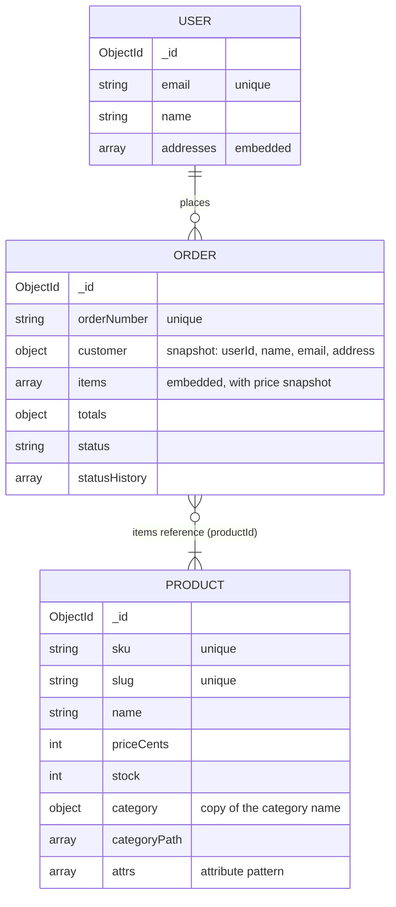

# Part 1: initial schema design

The code for this design is in [src/initial/schema.js](../src/initial/schema.js) (collections, validators, indexes) and [src/initial/store.js](../src/initial/store.js) (the queries). [test/initial.test.js](../test/initial.test.js) checks it.

## 1. Requirements and access patterns

With NoSQL you design from the **queries**, not from the data. So I started by listing what the application does and how often:

| # | What the app does | How often | How it's answered |
|---|---|---|---|
| 1 | Search products by words ("noise cancelling headphones") | very often | text index on name, brand, description |
| 2 | Browse a category, sorted by price, with a price range | very often | index `{status, categoryPath, priceCents}` |
| 3 | Open a product page | very often | unique index on `slug` |
| 4 | Filter by an attribute (color, size…) | often | index on `attrs.k, attrs.v` |
| 5 | Place an order (check stock, take stock, save order) | **thousands per second** | 1 transaction: conditional stock updates + 1 insert |
| 6 | Update the delivery status | often | 1 atomic update on 1 document |
| 7 | "My orders", newest first | often | index `{customer.userId, createdAt}` |
| 8 | Back office: orders with a given status | sometimes | index `{status, createdAt}` |

## 2. Entities

- **User**: account, name, email, addresses.
- **Product**: catalog item with a price, stock, a category and attributes that are different for each type of product.
- **Order**: who ordered, what, at what price, where to deliver, and the delivery status with its history.
- Category, address, order item and status change are **not** separate collections. They live inside the documents above (see section 4).



## 3. Choosing the NoSQL model

| Model | Example | Good at | Problem for this shop |
|---|---|---|---|
| **Document** | MongoDB | flexible documents, secondary indexes, text search, transactions, sharding | (chosen) |
| Key-value | Redis, DynamoDB | very fast reads/writes by key | you can only ask "give me key X". Browsing a category or searching needs extra index tables you maintain yourself |
| Wide-column | Cassandra | huge write volumes, always available | one table per query, no real text search, and no "check stock then decrement" in one step without a lightweight transaction |
| Graph | Neo4j | relationships ("customers who bought this also bought…") | not the core need, and slower for simple lookups and high write volumes |

I chose the **document model (MongoDB)** because:
- **An order is naturally one document.** The order, its items, the customer snapshot and the status history are always read and written together, so storing them together means one read and one write, with no joins.
- **Products are all different.** A shirt has a size, a laptop has RAM and headphones have a battery life. A flexible document handles that, and the attribute pattern keeps it indexable.
- **It covers every query in the table.** It has secondary indexes and a built-in text index, and multi-document ACID transactions for the stock and order together.
- **It can scale out later** with sharding, which is what Part 2 does.

A key-value store like Redis would still be a good *addition* for shopping carts and sessions (short-lived, read by key only), but it isn't needed for the requirements here.

## 4. Embed or reference?

| Relationship | Decision | Why |
|---|---|---|
| User → addresses | **embed** | few per user, always shown with the user |
| Order → items | **embed** | read and written as one unit. Bounded: at most 100 items |
| Order → customer | **embed a snapshot** + keep `userId` | the order must show the address it was *delivered to*, even if the user moves later (extended reference pattern) |
| Order item → product | **reference** (`productId`) + copy of name, sku and price | the price paid must not change when the product's price changes |
| Order → status history | **embed** | small, always shown with the order |
| Product → category | **copy** the category name and path into the product | categories rarely change, and the product page and browsing need them without a second query |
| User → orders | **reference** (`customer.userId` in the order) | a user can have thousands of orders: embedding them would make the user document grow forever |

## 5. Example documents

**Product**
```json
{
  "_id": "ObjectId(...)",
  "sku": "HEA-00001",
  "name": "Sonora Noise Cancelling Headphones (blue)",
  "slug": "sonora-noise-cancelling-headphones-blue-1",
  "description": "Noise Cancelling Headphones by Sonora in blue. ...",
  "brand": "Sonora",
  "category": { "slug": "headphones", "name": "Headphones" },
  "categoryPath": ["electronics", "audio", "headphones"],
  "priceCents": 7899,
  "currency": "USD",
  "attrs": [{ "k": "color", "v": "blue" }],
  "stock": 412,
  "status": "active",
  "rating": { "avg": 4.4, "count": 120 }
}
```

**Order**
```json
{
  "_id": "ObjectId(\"6738...\")",
  "orderNumber": "ORD-20261120-6738A1F0C2D4E5F6A7B8C9D0",
  "customer": {
    "userId": "ObjectId(...)",
    "name": "Ada Okafor",
    "email": "ada.okafor.0@example.com",
    "shippingAddress": { "line1": "12 Market Street", "city": "Lagos", "country": "NG", "postalCode": "10001" }
  },
  "items": [
    { "productId": "ObjectId(...)", "sku": "HEA-00001", "name": "Sonora Noise Cancelling Headphones (blue)",
      "unitPriceCents": 7899, "quantity": 2, "lineTotalCents": 15798 }
  ],
  "totals": { "subtotalCents": 15798, "shippingCents": 0, "totalCents": 15798 },
  "status": "paid",
  "statusHistory": [
    { "status": "pending", "at": "2026-11-20T10:00:00Z" },
    { "status": "paid", "at": "2026-11-20T10:01:12Z" }
  ],
  "createdAt": "2026-11-20T10:00:00Z",
  "updatedAt": "2026-11-20T10:01:12Z"
}
```

Money is stored as **integer cents**, so totals never have floating-point rounding errors.

Every collection also has a **`$jsonSchema` validator**, so MongoDB itself refuses a negative price, an order without items or an unknown status, whatever bug the application might have.

## 6. Indexes

| Collection | Index | For query # |
|---|---|---|
| products | `{sku: 1}` unique, `{slug: 1}` unique | 3, and placing orders by sku |
| products | text index on `name` (weight 10), `brand` (5), `description` (1) | 1 |
| products | `{status: 1, categoryPath: 1, priceCents: 1}` | 2: equality fields first, then the sort field (ESR rule), so the results come out of the index already sorted |
| products | `{attrs.k: 1, attrs.v: 1}` | 4 |
| users | `{email: 1}` unique | login |
| orders | `{orderNumber: 1}` unique | find an order by its number |
| orders | `{customer.userId: 1, createdAt: -1}` | 7 |
| orders | `{status: 1, createdAt: -1}` | 8 |

The tests check with `explain()` that each query really uses its index. For example, browsing "audio" by price reads exactly 20 documents for 20 results, and "my orders" reads 10 documents out of 100,000 (see [demo-output.txt](demo-output.txt)).

## 7. Consistency

- **Placing an order is one multi-document transaction.** For each item it runs `findOneAndUpdate({ sku, stock: { $gte: qty } }, { $inc: { stock: -qty } })`, then it inserts the order. If any item is out of stock, everything is rolled back. The test with 20 customers racing for the last 3 items gets exactly 3 orders and stock 0.
- **The delivery status is one atomic update on one document.** The filter only matches when the order's current status is allowed to move to the new one (`pending → paid → shipped → delivered`, and cancel only from pending or paid). Two workers can't both ship the same order, and an order can't go back. No transaction is needed.
- **Cancelling** changes the order and gives the stock back, so it's a transaction.
- **Writes use `w: majority`.** An order is only confirmed once most nodes of the replica set have it, so it survives the primary crashing right after.

## 8. Scalability (thousands of transactions per second)

- **An order is a single insert** of one document. There's no join and no second collection to update, apart from the stock.
- **There's no central counter** for order numbers. The number is built from the order's ObjectId, which is unique by construction. A counter document would be updated by every order and become a bottleneck.
- **Stock updates only lock the products in that order**, so orders for different products don't wait for each other.
- **Every read uses an index**, so the database does a small amount of work per request.
- **Measured:** about **3,000 orders per second** on my laptop, with each order a full transaction written with `w: majority`, on a 3-node replica set where all 3 nodes run on the same machine.

At this stage everything runs on one replica set. That's enough for these requirements, and Part 2 adds sharding for when it isn't.
