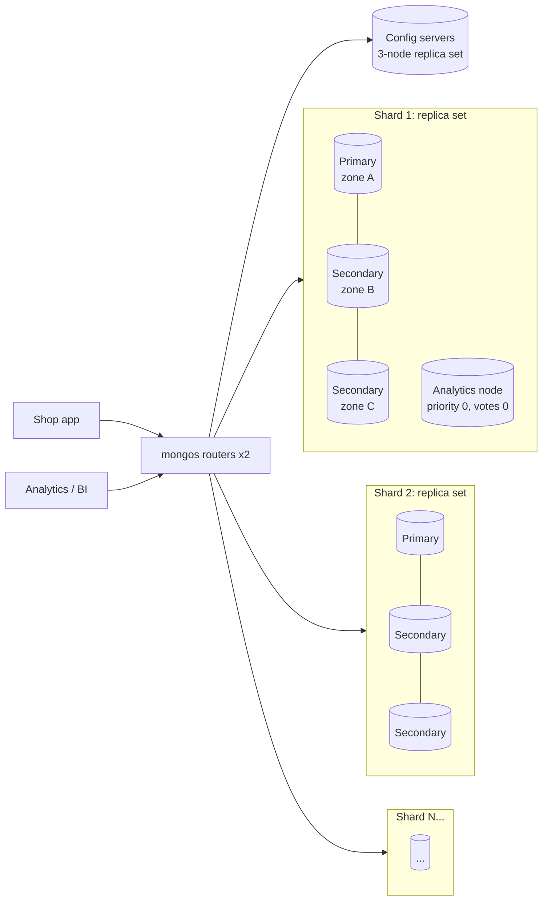

# Part 2: refactored schema design

The new requirements:
- **Analytics:** large-scale queries on product trends and sales.
- **High availability and partition tolerance** for many more users.

I used all three strategies the brief mentions (denormalization, sharding and replication), each for a different problem.

The code is in [src/refactored/](../src/refactored/): `schema.js`, `analytics.js`, `connection.js`, `migrate.js`, `refactor.js` and `store.js`. The cluster scripts are in [deploy/](../deploy/). [test/refactored.test.js](../test/refactored.test.js) and [test/availability.test.js](../test/availability.test.js) check it.

## What changed

| | Version 1 | Version 2 |
|---|---|---|
| Order items | sku, name, price, quantity | **+ category, brand** (copied from the product) |
| Orders | | **+ `schemaVersion: 2`**, indexes on `updatedAt` and `createdAt` for the analytics job |
| Order number | unique index | **no unique index** (impossible on a sharded collection). Uniqueness comes from the ObjectId inside the number |
| Shard key | none | **hashed `customer.userId`** |
| Products | | **+ `sales30d`** (units and revenue over the last 30 days) and a "trending" index |
| New collections | | **`sales_daily_product`**, **`sales_daily_category`**, `jobs` |
| Reads | everything from the primary | **catalog from secondaries, orders from the primary, analytics from a dedicated node** |
| Cluster | 1 replica set | **sharded cluster, each shard a 3-node replica set, plus an analytics node** |



## 1. Denormalization and pre-aggregation (for analytics)

**The problem.** A report like "sales per category over the last 3 months" on the version 1 schema has to read every order in that period. It also has to look up each product to find its category, because orders didn't store it. With thousands of orders per second, that means millions of documents for every report, and the reports would be fighting the customers for the same database.

**The changes:**

1. **Copy `category` and `brand` into each order item.** The data is now in the order, so no lookup in products is needed. It's a snapshot, like the price: if a product moves to another category later, past sales stay where they were sold.

2. **Pre-aggregated summary collections.** A job summarises the orders into one document per product per day and one per category per day:

   ```json
   // sales_daily_product
   { "_id": { "day": "2026-10-14T00:00:00Z", "productId": "ObjectId(...)" },
     "day": "2026-10-14T00:00:00Z", "productId": "ObjectId(...)",
     "sku": "FIT-00007", "name": "Peakform Yoga Mat (blue)", "category": "fitness", "brand": "Peakform",
     "units": 31, "revenueCents": 61969, "orders": 28, "computedAt": "2026-11-20T10:05:00Z" }

   // sales_daily_category
   { "_id": { "day": "2026-10-14T00:00:00Z", "category": "fitness" },
     "day": "2026-10-14T00:00:00Z", "category": "fitness",
     "units": 1650, "revenueCents": 23345000, "orders": 1190, "computedAt": "2026-11-20T10:05:00Z" }
   ```

   Their size depends on the number of products and days, **not on the number of orders**. A year of 200 products is at most 73,000 small documents, whether the shop sells 1,000 or 10 million orders.

3. **`sales30d` inside each product**, so the shop can show "trending in this category" with one indexed query on products. The catalog never touches the analytics data.

**How the summaries stay up to date** (`runSalesRollup` in [analytics.js](../src/refactored/analytics.js), run every few minutes):
- **It's incremental.** It finds the orders created *or changed* since its last run (index on `updatedAt`) and recomputes only the days those orders belong to. A cancelled order from last week updates last week's numbers.
- **It's idempotent.** Each day is recomputed from scratch with `$merge`, so running it twice gives the same result, and a crash in the middle is fixed by the next run.
- **It doesn't slow down orders.** The alternative was to `$inc` the summary in the same transaction as the order. But then thousands of orders per second would all update the same "today, best-selling product" document, a hot spot that would slow down checkout. A few minutes of delay in the reports is a better trade.

**Measured** on 100,000 orders ([demo-output.txt](demo-output.txt)):

| Report | Read from raw orders | Read from summaries |
|---|---|---|
| Sales per product, October | 54,088 orders | **6,200** summaries (9× less) |
| Units per category, Aug–Oct | 95,003 orders | **899** summaries (100× less) |

The gap grows with the number of orders. The tests also check that both ways give **exactly the same numbers**.

## 2. Sharding (for volume)

**Only `orders` is sharded**, because it's the only collection that grows without limit and takes most of the writes. See [deploy/sharding.js](../deploy/sharding.js).

Choosing the shard key:

| Candidate | Problem |
|---|---|
| `createdAt` or `_id` (ObjectId) | always increasing, so every new order goes to the same "last" shard (a hot shard), and the other shards do nothing |
| `status` | only 5 values, so at most 5 chunks, and "pending" would be the hot one |
| `orderNumber` | evenly spread, but "my orders" would have to ask every shard |
| **`customer.userId` hashed** | **chosen**: hashing spreads the writes evenly across shards, and "my orders" includes the customer id, so it goes to **one** shard |

What this costs:
- **Queries without the customer id ask every shard.** That's the back office "all paid orders" and finding an order by its number. They're rare and still use an index on each shard. The big reports don't read orders anymore (section 1).
- **No unique index on `orderNumber`.** MongoDB can only enforce a unique index on a sharded collection if it starts with the shard key. So I removed it, and the order number is now built from the order's ObjectId, which is unique by construction.
- **Placing an order becomes a distributed transaction.** Products (unsharded) live on one shard and the order on another. MongoDB supports this, but it's slower than a transaction on one replica set.

**Not sharded, on purpose:**
- **products and users** are small enough for one shard and mostly read. Read capacity grows by adding replicas instead. Sharding products would also make every text search ask every shard, and the unique index on users' email only works unsharded.
- **The summary collections** are small by design.

## 3. Replication (for availability)

Every shard is a replica set of **3 nodes in 3 availability zones**, plus **one analytics node** with priority 0 (it can never become primary) and 0 votes. See [deploy/replica-set.js](../deploy/replica-set.js). If a node or a whole zone goes down, the other two are still a majority, so they elect a new primary.

### Consistency vs availability, per type of data

The CAP theorem says that during a network partition you have to choose between consistency and availability. I didn't make one choice for the whole database: I made it **per type of data**, with read preferences and write/read concerns ([connection.js](../src/refactored/connection.js)).

| Data | Choice | Settings | What it means |
|---|---|---|---|
| **Catalog** (browse, search, product page) | **availability** (AP) | `readPreference: secondaryPreferred`, `maxStalenessSeconds: 90`, `readConcern: local` | Any node can answer, even when there's no primary. A price or stock count can be a few seconds old, which is safe because the order transaction checks price and stock again on the primary. |
| **Orders** (place, pay, ship, my orders) | **consistency** (CP) | `w: majority`, `readConcern: majority`, primary reads, `retryWrites` | A confirmed order is never lost and the customer always sees their own order. During an election (a few seconds) new orders wait, and the driver retries them automatically. |
| **Analytics** | **availability, eventual** | `readPreference: secondaryPreferred` with tags `[{nodeType: 'ANALYTICS'}, {}]` | Reports go to the analytics node, or any secondary if it's down, and never slow down the nodes that serve customers. They're a few minutes behind anyway (section 1). |

**Why orders aren't fully "AP".** A database like Cassandra stays writable on both sides of a partition. But then two sides can each sell the last item, or one order can end up with two different statuses, and someone has to reconcile that afterwards. For money and stock I prefer a few seconds of waiting during a failover. The tests show it's short.

**Measured** ([test/availability.test.js](../test/availability.test.js)): I kill the primary with SIGKILL (a real crash) in the middle of the test.
- Browsing the catalog keeps working: answered **3 ms** after the crash, by a secondary.
- The next order waits for the election and goes through about **2 seconds** after the crash. The test uses a 2-second election timeout; with the default 10 s it would be about 10–12 s. No error reaches the customer, because the driver retries.
- The order confirmed just before the crash is still there on the new primary, thanks to `w: majority`.

## 4. Migrating a live database (version 1 → 2)

[refactor.js](../src/refactored/refactor.js) does it without stopping the shop:

1. **Deploy the version 2 app first.** Version 2 orders also pass the version 1 validator, since they only have extra fields, so old and new code can run side by side.
2. **Switch on the version 2 validator with `validationLevel: "moderate"`.** New and already-valid documents must follow version 2, but old version 1 orders aren't rejected while they wait for the migration.
3. **Migrate the old orders in batches of 1,000** ([migrate.js](../src/refactored/migrate.js)): look up each product's category and brand once, then set them on the items with one `bulkWrite` per batch. It only touches orders without `schemaVersion: 2`, so it can be stopped and restarted, and running it twice changes nothing (tested).
4. **Switch the validator to `strict`.** A version 1 order is now refused (tested).
5. **Create the new indexes, drop the unique `orderNumber` index,** then run the analytics job for the first time.
6. **Shard `orders`** with [deploy/sharding.js](../deploy/sharding.js).

On my laptop, steps 2–5 took **10.6 s** for 103,000 orders.

## 5. Trade-offs I accepted

| Gained | Paid |
|---|---|
| Reports read 9–100× fewer documents and run on their own node | Summaries are a few minutes behind, and there's a job to run and monitor |
| Category and brand in order items, so no lookups for analytics | A bit more storage per order, and old orders keep the old category if a product moves (on purpose: it's history) |
| Write capacity grows by adding shards, and "my orders" goes to one shard | Some back-office queries ask every shard, no unique `orderNumber` index, and order transactions span shards |
| Catalog stays readable through failures and partitions | Catalog reads can be up to 90 s stale (checked again at checkout) |
| Orders never lost, never double-sold | Order writes pause for the election time (seconds) when a primary dies |
