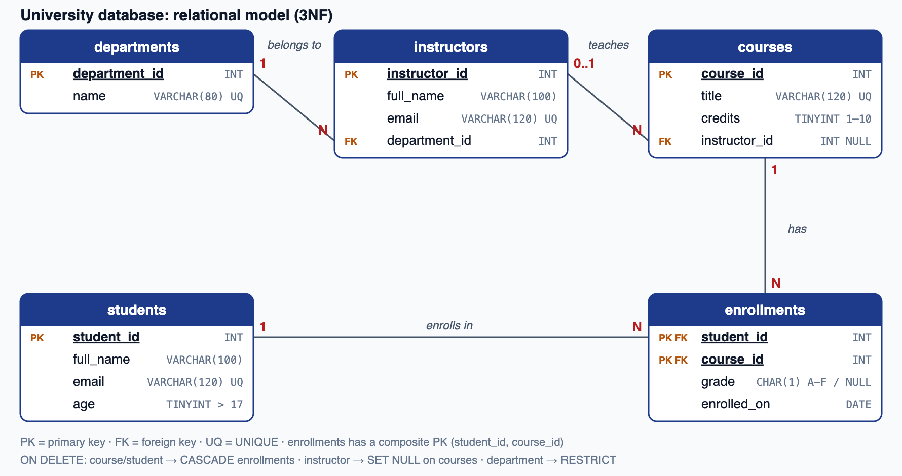

# University Database (SQL)

For this checkpoint I designed a small database for a university. It stores students, instructors, courses and which students are enrolled in which courses. I wrote it for **MySQL 8 or newer**.



## Files

- `checkpoint.sql`: everything in one file (steps 1 to 4), ready to run in MySQL Workbench
- `sql/01_schema.sql`: step 1 and 2, the tables with their keys and constraints
- `sql/02_data.sql`: step 3, the sample data
- `sql/03_queries.sql`: step 4, the five queries
- `sql/04_constraint_tests.sql`: extra statements that *should fail*, to prove the constraints work
- `results.md`: the real output of every statement
- `model.png`: the diagram above

## How to run it

In **MySQL Workbench** (or the `mysql` command line), create an empty database and run `checkpoint.sql`.

Or, without installing MySQL:

```bash
npm install
npm start
```

`run.js` starts a temporary MySQL server, runs the four files in order, prints every result and saves them in `results.md`. The first time, it has to download MySQL, which takes a minute or two.

## Step 1: Designing the schema

I started with the four tables from the instructions and checked them against the normal forms:

- **1NF:** every column holds one value. For example, a student doesn't have a "courses" column with a list like "DB, Web". Each enrollment is its own row in `enrollments`.
- **2NF:** `enrollments` has a composite primary key (`student_id`, `course_id`). The grade depends on *both* (a student's grade *in that course*), so it belongs there. I didn't copy the student's name or the course title into `enrollments`, because those depend on only half of the key.
- **3NF:** the instructions put `department` directly in Instructors. But several instructors work in the same department, so the department name would be repeated, and renaming a department would mean updating many rows. So I made a separate **`departments`** table, and `instructors` stores only `department_id`. Now each fact is stored in one place.

I also linked each course to its instructor with `courses.instructor_id`, which is needed for query 2. I assumed one instructor per course, and the column can be `NULL` for a course that doesn't have one yet.

## Step 2: Keys and constraints

Every table has a **primary key**, and the links between tables are **foreign keys**. The other constraints I used:

| Constraint | Where | Why |
|---|---|---|
| `NOT NULL` | names, emails, age, title, credits | these must always be filled in |
| `UNIQUE` | student and instructor emails, course titles, department names | no two students can share an email, etc. |
| `CHECK (age > 17 AND age < 100)` | students | from the instructions; the upper limit catches typos |
| `CHECK (credits BETWEEN 1 AND 10)` | courses | a course can't have 0 or negative credits |
| `CHECK (grade IN ('A'…'F'))` | enrollments | only real grades; `NULL` means the course is still in progress |
| `CHECK (email LIKE '%_@_%._%')` | students, instructors | a simple check that it looks like an email |
| Composite `PRIMARY KEY (student_id, course_id)` | enrollments | a student can't enroll in the same course twice |

I thought about what should happen when something is deleted:

- **Deleting a course or a student** also deletes their enrollments (`ON DELETE CASCADE`). An enrollment for a course that no longer exists makes no sense, and this is what lets step 4's "delete a course" work.
- **Deleting an instructor** keeps their courses but sets the instructor to `NULL` (`ON DELETE SET NULL`), because the course still exists and can get a new teacher.
- **Deleting a department** is blocked (`ON DELETE RESTRICT`) while instructors still belong to it.

## Step 3: Sample data

There are 3 departments, 4 instructors, 5 students, 4 courses and 7 enrollments. I chose the data so every query has something interesting to show:

- **David Mensah** isn't enrolled in anything (for query 3).
- **Technical Writing** has no instructor yet (for query 2).
- One enrollment has no grade yet, because that course is still in progress.

## Step 4: The queries

1. **Students in "Database Systems":** I join `students` → `enrollments` → `courses` and filter on the course title. Result: Amina, Chinedu and Fatima.
2. **Courses with their instructor's name:** I used a `LEFT JOIN` instead of a normal `JOIN`. With a normal join, Technical Writing would disappear because it has no instructor. With `LEFT JOIN`, it's listed as "(not assigned yet)". I also showed the department, through the new `departments` table.
3. **Students not enrolled in any course:** I used `NOT EXISTS`, which keeps a student when there is no enrollment row for them. Result: David Mensah. (A `LEFT JOIN … WHERE e.student_id IS NULL` would also work.)
4. **Update a student's email:** `UPDATE students SET email = … WHERE student_id = 2`. The `WHERE` is very important, because without it *every* student would get the same email. (The `UNIQUE` constraint would actually block that.) I run a `SELECT` after it to show the change.
5. **Delete a course by its ID:** `DELETE FROM courses WHERE course_id = 1`. I deleted Database Systems on purpose, because it has 3 enrollments. The check afterwards shows that `ON DELETE CASCADE` removed those enrollments too, so nothing is left pointing at a course that doesn't exist.

The real output of all of these is in [`results.md`](results.md).

## Testing the constraints

To make sure the constraints really work, `sql/04_constraint_tests.sql` tries 10 things that should be refused:

- a 16-year-old student
- a duplicate email
- a missing name
- an email without an @
- a duplicate course title
- a course with 0 credits
- an enrollment for a student who doesn't exist
- enrolling the same student twice
- a grade of "Z"
- deleting a department that still has instructors

`run.js` checks that each one fails *with the error I expected*. This mattered: the first time I ran it, one test was failing for the wrong reason (a foreign key error instead of the duplicate error), because my sample data hadn't loaded properly. Checking the exact error code caught that. All 10 are now rejected correctly.
